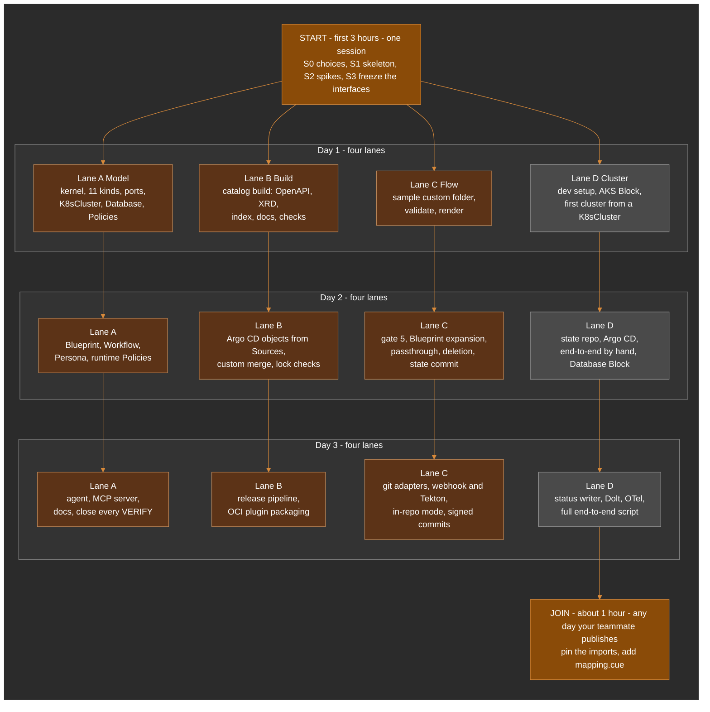

# openCP: Full-Scope 3-Day Plan (core repo track)

Status: a plan. Nothing here is built yet. It follows `opencp-service-catalog-design-v5.md` (called "v5" below).
I could not run CUE where I wrote this, so every command and snippet is a first draft. Block S2 proves them on your machine in the first hours. `# VERIFY:` marks anything to check on your pinned tool versions. Hours are estimates.

**This replaces `opencp-3-day-plan.md`.** That plan fit 3 days by leaving ten things out. This one leaves nothing out. It fits 3 days a different way: four lanes of work running side by side.

---

## 0. Read this first

### 0.1 The scope: everything on the openCP side that does not need the imports

| # | Result at the end of day 3 | Was it cut in the old 3-day plan? |
|---|---|---|
| 1 | Kernel: envelope, references, **all 11 kinds in full**, ports, bindings schema | Three kinds were stubs |
| 2 | Contracts: `K8sCluster` **and `Database`** | Database was cut |
| 3 | `task catalog:build`: OpenAPI, XRDs, index, docs, agent tool specs, drift check, layer check | Docs and tool specs were cut |
| 4 | Gates 1 to 5: `task request:validate` and `task request:render` | Kept |
| 5 | **Blueprint expansion**, **passthrough**, **all three deletion modes** | Cut |
| 6 | Two real Blocks from Requests to Azure: AKS cluster and Postgres database | Database was cut |
| 7 | State target in **both modes** (separate repo and `custom/state/`), Argo CD wiring generated from Sources | In-repo mode was cut |
| 8 | **Automation**: webhook, Tekton, PR check and comment, bot commit to state | Cut |
| 9 | **Status writer** with Entity files in git, **and the Dolt adapter** | Cut |
| 10 | **Signals**: OTel to Grafana, one dashboard and one alert | Cut |
| 11 | **Release pipeline**: manifest, checksum check, auto-fetch PR with re-check and render diff | Cut |
| 12 | **OCI plugin packaging**: pack, sign, lock, vendor by bot PR | Cut |
| 13 | **Agents**: an agent Actor that writes a Request PR, and a small MCP server | Cut |
| 14 | Lock checks and `requiresCue` checks, built and tested against a dummy module | Was "wait for the imports" |
| 15 | The join step, reduced to about one hour of work when your teammate publishes | Was outside the plan |

### 0.2 How full scope fits in 3 days



Five rules make this work. Break one and the 3 days do not hold.

1. **Freeze the interfaces first (block S3).** File formats, command names and example files are fixed in the first 3 hours. After that, each lane builds against those example files, not against another lane's unfinished code.
2. **Four Claude sessions, one per lane, each in its own git worktree.** Each lane owns its own folders (section 2.2), so they do not collide.
3. **Only lane D touches the cluster and Azure.** One source of changes there.
4. **You review the "Done when" checklist and the tests, not every line.** Four lanes produce more code than one person can read. Tests written first are what you trust.
5. **One small PR per task,** merged only when `task test` and `task catalog:check` are green.

### 0.3 Where the time is not in your hands

Lanes A, B and C are offline. Their speed is up to you and Claude. Lane D waits on Azure and Crossplane. Tasks marked **[cloud wait]** are the ones that can slip. Each one names an offline task to do while it waits, so no hour is lost. Nothing is cut: a stalled cloud task keeps its place and is retried.

---

## 1. The first 3 hours (one session, before the lanes split)

### S0 — Lock the choices and send the hand-off file (30 min)

Take these unless you already disagree. Write them in `docs/decisions.md`.

| Choice | Value |
|---|---|
| API domain | `opencp.dev` |
| Core CUE module | `opencp.dev/core@v0` |
| API groups | `catalog.opencp.dev` (kernel kinds), `compute.opencp.dev` (`K8sCluster`), `data.opencp.dev` (`Database`), `blueprints.opencp.dev` (Blueprint kinds) |
| Build tools | Python, called from Taskfile. CUE does all schema and rule work. |
| Dev git platform and CI | Gitea, with Tekton in the cluster |
| Dev registry | One OCI registry you control, for plugins and CUE modules |
| Azure | One **dev-only** subscription with a **budget cap**. Lane D's identity can touch only that. |

```yaml
# docs/imports-handoff.yaml      send this to your teammate today
modulePathPattern: opencp.dev/imports/<tool>@v0      # VERIFY: a name you will own
registry: <your dev OCI registry>
firstImports:
  - tool: crossplane
    kinds: [Composition, CompositeResourceDefinition]
  - tool: <filled in after spike E>
    kinds: [<the kinds your Compositions create, for the cluster AND the database>]
  - tool: argocd
    kinds: [Application, AppProject, ApplicationSet]
readySignal: a published version tag plus its OCI digest
```

**Done when:** choices are written down, and your teammate has the file.

### S1 — Repo skeleton, Taskfile, worktrees (1 hour)

Create the layout from v5 section 12.2, plus `tests/` and `docs/`:

```
opencp/
├── cue.mod/module.cue            # cue mod init opencp.dev/core@v0
├── Taskfile.yml
├── .tool-versions                # exact versions: cue, task, python, pytest, bats, yq, kubectl,
│                                 #   crossplane, oras, cosign, syft
├── kernel/{schema,ports,tools}/
├── capabilities/{compute,data}/
├── plugins/  blueprints/  workflows/  policies/  defaults/  agents/  interfaces/
├── runtime/  releases/  _generated/
├── custom/                       # ships EMPTY upstream (a README only)
├── tests/
│   ├── fixtures/{kernel,requests,custom,plugins}/
│   ├── golden/                   # expected output files
│   ├── bats/
│   └── e2e/
└── docs/                         # v5, this plan, decisions.md, interfaces.md, imports-handoff.yaml
```

Every task in the Taskfile takes the custom folder and the state folder as parameters. The repo's own `custom/` stays empty. That is what makes every tool testable.

```yaml
# Taskfile.yml   (the full task list for the 3 days. Lanes fill in the bodies.)
version: '3'
vars:
  CUSTOM: '{{.CUSTOM | default "tests/fixtures/custom"}}'
tasks:
  test:              {desc: every offline test,            cmds: [bats tests/bats, pytest -q kernel/tools]}
  lint:layers:       {desc: no tool imports in contracts,  cmds: [python3 kernel/tools/layers.py]}
  catalog:build:     {cmds: ['python3 kernel/tools/catalog.py build --custom {{.CUSTOM}}']}
  catalog:check:     {desc: rebuild and fail on any difference, cmds: ['python3 kernel/tools/catalog.py check --custom {{.CUSTOM}}']}
  request:validate:  {cmds: ['python3 kernel/tools/request.py validate --custom {{.CUSTOM}} {{.CLI_ARGS}}']}
  request:render:    {cmds: ['python3 kernel/tools/request.py render --custom {{.CUSTOM}} {{.CLI_ARGS}}']}
  state:commit:      {cmds: ['python3 kernel/tools/state.py commit --custom {{.CUSTOM}} {{.CLI_ARGS}}']}
  state:rerender:    {cmds: ['python3 kernel/tools/state.py rerender --custom {{.CUSTOM}} {{.CLI_ARGS}}']}
  state:drift:       {cmds: ['python3 kernel/tools/state.py drift --custom {{.CUSTOM}} {{.CLI_ARGS}}']}
  inventory:write:   {cmds: ['python3 kernel/tools/inventory.py write {{.CLI_ARGS}}']}
  workflow:compile:  {cmds: ['python3 kernel/tools/workflow.py compile {{.CLI_ARGS}}']}
  plugin:pack:       {cmds: ['python3 kernel/tools/plugin.py pack {{.CLI_ARGS}}']}
  plugin:vendor:     {cmds: ['python3 kernel/tools/plugin.py vendor --custom {{.CUSTOM}} {{.CLI_ARGS}}']}
  release:build:     {cmds: ['python3 kernel/tools/release.py build {{.CLI_ARGS}}']}
  release:verify:    {cmds: ['python3 kernel/tools/release.py verify {{.CLI_ARGS}}']}
  release:fetch:     {cmds: ['python3 kernel/tools/release.py fetch --custom {{.CUSTOM}} {{.CLI_ARGS}}']}
  upstream:check:    {desc: fail if a file outside custom/ differs from the release, cmds: ['python3 kernel/tools/release.py upstream-check']}
  e2e:slice1:        {cmds: [bash tests/e2e/slice1.sh]}
  e2e:cleanup:       {desc: delete every Azure resource tagged opencp-e2e, cmds: [bash tests/e2e/cleanup.sh]}
```

Then make the four worktrees:

```bash
git worktree add ../opencp-lane-a -b lane-a
git worktree add ../opencp-lane-b -b lane-b
git worktree add ../opencp-lane-c -b lane-c
git worktree add ../opencp-lane-d -b lane-d
```

**Test first:** one bats test that runs `task --list` and expects every task name above.
**Done when:** `task test` passes, and the CI file contains only `task` calls.

### S2 — Eight spikes: prove the commands (1.5 hours, two people-streams)

Use a throwaway 5-line schema in a scratch folder. For each spike, write the exact command that worked and what the output looked like in `docs/decisions.md`. **If B, C or D fails, stop and fix the plan before the lanes start.**

| Spike | Try | Write down |
|---|---|---|
| **A** Check YAML against a definition | `cue vet -c -d '#Thing' ./pkg/ file.yaml` | The flags that work. The error text for a bad file. |
| **B** Export OpenAPI | `cue def pkg/schema.cue --out openapi+yaml` | How a default, a `{...}` and an embedded definition appear. Whether `rules.cue` stays out when you pass only one file. |
| **C** Fill defaults | `cue export ./pkg/ file.yaml -d '#Thing' --out yaml` | Whether defaults appear in the output. |
| **D** A real cluster accepts an XRD | Hand-write a 3-field XRD. `kubectl apply --dry-run=server -f xrd.yaml` | The `apiVersion` your Crossplane accepts. How an XRD names its default Composition. |
| **E** Read your prototype's Composition | Open it in `platform/crossplane/` | The function it uses. The `apiVersion` and `kind` of every resource it creates. **Send this to your teammate.** |
| **F** A local CUE registry | Start a local OCI registry. `cue mod publish v0.0.1` a 5-line dummy module. Import it from a second module with `CUE_REGISTRY` set. | The commands. How to read the module's digest from the registry. `# VERIFY: cue mod registry, or run a registry container` |
| **G** Render a Composition offline | `crossplane render xr.yaml composition.yaml functions.yaml` | Whether it runs on your machine, and what it needs. `# VERIFY` |
| **H** Argo CD reads a Gitea repo | One ApplicationSet with a git directory generator, syncing one ConfigMap | The fields that work on your Argo CD version. |

A, B, C and F are offline. D, E, G and H need the cluster. Run the two groups at the same time.

**Done when:** all eight answers are written down, with a named workaround for anything that failed.

### S3 — Freeze the interfaces (1 hour, runs beside S2)

Write `docs/interfaces.md`. This file is the contract between the four lanes. Changing it later needs a PR that all lanes rebase on.

| # | Frozen item | Source |
|---|---|---|
| 1 | Folder layout | v5 section 12 |
| 2 | Every `task` name, its arguments, and exit codes (0 pass, 1 gate fail, 2 tool error) | S1 |
| 3 | The gate result, as JSON | below |
| 4 | The catalog index format | below |
| 5 | The final manifest format and its annotations | v5 section 8.5 |
| 6 | The state target layout and the commit trace lines | v5 section 7.3 |
| 7 | The Entity format | v5 section 8.6 |
| 8 | The Policy rule interface, the Blueprint interface, the adapter commands | below |

```yaml
# 3. gate result  (printed with --json by validate and render)
result: fail                     # pass | fail
gate: 2                          # 1..5
rule: ha-needs-medium-or-large
file: requests/payments-dev.yaml
field: spec.size
reason: "ha is true, so size must be medium or large"
```

```yaml
# 4. _generated/catalog-index.yaml
# GENERATED
capabilities:
  k8s-cluster:
    kind: K8sCluster
    apiVersion: compute.opencp.dev/v1alpha1
    package: capabilities/compute/k8s-cluster
    visibleTo: [Persona/platform-engineer, Persona/sre]
    blocks:
      - {name: aks, plugin: azure-aks, provisioner: crossplane, supports: {cloud: [azure]}, deletionDefault: delete}
blueprints:
  team-environment: {kind: TeamEnvironment, apiVersion: blueprints.opencp.dev/v1alpha1, package: blueprints/team-environment}
policies:
  - {name: prod-clusters-must-be-ha, tier: enforced, engine: cue, kinds: [K8sCluster], targets: ["Target/*-prod-*"]}
ports:
  git-platform: {adapters: [gitea, github]}
```

```cue
// 8a. A Policy rule file (engine: cue). The gate fails if `violations` is not empty.
#Check: {
	in: {manifest: _, target: _, source: _}
	violations: [...string]
}

// 8b. A Blueprint is a CUE function: its own input in, a set of Capability Requests out.
#Expand: {
	in:  _            // the Blueprint's own kind
	out: [ID=string]: _   // each value is a Capability Request, type-checked against its contract
	order: [...string]    // ids, in dependency order
}
```

```
# 8c. A git-platform adapter is one script with these commands (same for gitea and github)
comment-pr   set-status   open-pr   get-approvals   push
```

Then copy every example object from v5 section 8 into `tests/golden/` and `tests/fixtures/`. **These files are what the lanes build against.**

**Done when:** `docs/interfaces.md` is merged to `main`, and all four worktrees are rebased on it.

---

## 2. How to run the lanes

### 2.1 The prompt for every task

Give each Claude session this, one task at a time:

```
Read docs/opencp-service-catalog-design-v5.md, docs/interfaces.md and
docs/opencp-full-scope-3-day-plan.md. You are lane <A|B|C|D>. Do task <ID> only.

1. Resolve this task's VERIFY items by running the real command.
   Write each answer in docs/decisions.md.
2. Write the "Test first" items. Run them. They must fail.
3. Write the code until they pass.
4. Open one PR. Report each "Done when" checkbox as pass or fail. Then stop.

Rules:
- Touch only your lane's folders (plan section 2.2).
- Build against docs/interfaces.md and tests/golden/. Do not wait for another lane.
- No tool imports under kernel/, capabilities/, blueprints/ or policies/.
- Offline tests need no cluster and no network.
- Same input gives the same bytes: sorted keys, no timestamps.
- If the plan and reality disagree, stop and tell me. Do not work around it.
```

### 2.2 Who owns which folders

| Lane | Owns |
|---|---|
| **A Model** | `kernel/schema/`, `kernel/ports/`, `capabilities/`, `blueprints/`, `workflows/`, `policies/`, `defaults/`, `agents/`, `interfaces/` |
| **B Build** | `kernel/tools/catalog*`, `layers.py`, `lock.py`, `plugin.py`, `release.py`, `_generated/`, `releases/` |
| **C Flow** | `kernel/tools/request*`, `state.py`, `workflow.py`, `plugins/gitea/`, `plugins/github/`, `plugins/tekton/`, `tests/golden/render/` |
| **D Cluster** | `plugins/azure-aks/`, `plugins/azure-postgres/`, `plugins/argocd/`, `plugins/crossplane/`, `plugins/grafana-stack/`, `plugins/dolt/`, `kernel/tools/inventory.py`, `runtime/`, `tests/e2e/` |

### 2.3 Your own day

| When | You do |
|---|---|
| Start of day | Hand each lane its first task. |
| Every 2 to 3 hours | Read each open PR's "Done when" report and its tests. Merge if green. Hand out the next task. |
| Any time a lane stops with "plan and reality disagree" | Decide, write it in `docs/decisions.md`, update `docs/interfaces.md` if needed. |
| Your own hands-on work | A4 step 1 (sorting your prototype's fields) and watching lane D on Azure. |
| End of day | Run the end-of-day check. Start the night tasks. |

### 2.4 Nights

| Night | Leave running (offline, clear tests) |
|---|---|
| 1 | Two invalid fixtures for every rule in every kind and both contracts, each named for the rule it breaks. |
| 2 | Golden render cases for every Block-choice case, every Policy case, the Blueprint, passthrough and each deletion mode. |

Azure runs unattended only in the dev subscription with the budget cap, and only if the run ends with `task e2e:cleanup`.

---

## 3. Day 1

### Lane A — Model

**A1 — Envelope and references (1.5 h).**
- **Do:** `kernel/schema/envelope.cue`: `#Name`, `#Ref` (`Kind/name`), `#RefPattern` (allows `*`), `#Metadata`, `#Envelope`, `#RequestSpec` (`target`, `extensions?`, `resolved?`), `#Resolved` (`cloud`, `region`, `env`, `block`, `deletion`).
- **Test first:** valid and invalid YAML fixtures: bad name, bad reference, missing `kind`, name over 63 characters.
- **Done when:** every valid fixture passes and every invalid one fails for the reason in its file name.

**A2 — All 11 kinds, in full (3 h).**
- **Do:** one CUE file per kind in `kernel/schema/`, API group `catalog.opencp.dev/v1alpha1`. Fields from v5 sections 8 and 14.1. `Block.mapping` and `Plugin.requiresCue` are optional, so a Block can exist before the imports. Design the three kinds the old plan stubbed:
  - `Persona`: `title`, `description`. A Capability lists Personas in `visibleTo`.
  - `Blueprint`: `title`, `kind` and `apiVersion` of the Request it creates, `package` (where its `#Expand` lives), `parts` (id, capability, dependsOn).
  - `Workflow`: `inputs`, and `steps` (id, `run` = one Taskfile target, `args`, `needs`). A step may only call a `task`. That is the rule that keeps a Workflow tool-neutral.
- **Test first:** per kind, one valid and two invalid fixtures.
- **Done when:** every example object in v5 passes unchanged, and unknown fields are rejected in all 11 kinds.

**A3 — Ports and the bindings schema (1 h).**
- **Do:** `kernel/ports/<port>.cue` for the 13 ports in v5 section 4.1: name, job, how many adapters may be active. `#Bindings` schema for `custom/bindings.yaml`, including the `state` block (both modes).
- **Test first:** bindings fixtures: unknown port, two adapters on a one-adapter port, `in-repo` mode without a path.
- **Done when:** the v5 `bindings.yaml` passes, and each bad fixture fails.

**A4 — Contract: `K8sCluster` (2 h, of which 1 h is yours).**
- **Do, step 1 (you):** open your `XAKSCluster` XRD. Put every field in a bucket and write it in `docs/k8s-cluster-field-map.md`.

  | Bucket | The test | Where it goes |
  |---|---|---|
  | A. Every cloud has it | "Would EKS, GKE and on-prem also need this?" | A field in the contract |
  | B. Azure-only, user should not choose it | Subscription, resource group, network IDs | Target facts or Block defaults |
  | C. Azure-only, some users must set it | A special node pool option | `spec.extensions` |

- **Do, step 2:** `schema.cue` (embeds `#Envelope` and `#RequestSpec`), `rules.cue` (cross-field rules), `capability.yaml`. Starter code is in v5 section 8.1.
- **Test first:** the 8-line Request from v5 section 8.4 passes. Invalid: `bad-size`, `unknown-field`, `ha-on-small`, `missing-target`, `sets-resolved`.
- **Done when:** fixtures behave as named, the two CUE files import only the kernel, and every prototype field is in a bucket.

**A5 — Contract: `Database` (1 h).**
- **Do:** `capabilities/data/database/`: `engine`, `version`, `size`, `ha`, plus outputs `host`, `port`, `secretRef`. Same pattern as A4.
- **Test first:** one valid Request, four invalid.
- **Done when:** fixtures behave as named, **and no file under `kernel/` changed to make it work.** That is the proof the kernel is right.

**A6 — Global Policies and tiers (1.5 h).**
- **Do:** in `policies/`, with rule files that follow the `#Check` interface: `prod-clusters-must-be-ha` (enforced), `deletion-protection-prod` (enforced, sets mode `block`), `stateful-prod-orphans` (default, sets mode `orphan` for `Database` on prod), `report-extensions` and `report-passthrough` (optional, report only).
- **Test first:** each rule file run directly with `cue` against one passing and one failing manifest.
- **Done when:** all five behave, and none imports a tool module.

### Lane B — Build

**B1 — Validate the catalog and its references (2 h).**
- **Do:** `catalog.py build`, part 1 and 2. Find every YAML with `apiVersion: catalog.opencp.dev/...` in the repo and the custom folder. Check each against its kind. List every object as `Kind/name` and fail on any reference that points to nothing. Skip patterns with `*`.
- **Test first:** a fixture with a broken reference fails and names the file and the field.
- **Done when:** the build passes on the golden catalog and fails on each bad fixture.

**B2 — OpenAPI and XRD (3.5 h).**
- **Do:** for each Capability, export **only `schema.cue`** to `_generated/openapi/`. Turn it into a Crossplane XRD in `_generated/xrd/`: inline every `$ref`, merge every `allOf`, keep `default` values, mark open objects with `x-kubernetes-preserve-unknown-fields: true`, add a `status` block from the Capability's `outputs`. Use the answers from spikes B and D.
- **Test first:** golden files for both contracts. `tests/golden/xrd/k8s-cluster.yaml` and `database.yaml`.
- **Done when:** golden tests pass, building twice changes nothing, and lane D confirms `kubectl apply --dry-run=server` accepts both XRDs.

**B3 — Catalog index (1 h).**
- **Do:** write `_generated/catalog-index.yaml` in the frozen format.
- **Test first:** golden index for the fixture catalog.
- **Done when:** the golden test passes with two Capabilities, two Blocks, one Blueprint and five Policies.

**B4 — Drift check and layer check (1.5 h).**
- **Do:** `catalog:check` rebuilds into a temp folder and compares with committed `_generated/`. `layers.py` fails if any `.cue` under `kernel/`, `capabilities/`, `blueprints/` or `policies/` imports anything that is not `opencp.dev/core`.
- **Test first:** change a default without rebuilding: check fails. A fixture contract that imports `opencp.dev/imports/x`: layer check fails.
- **Done when:** both run in CI.

**B5 — Docs and agent tool specs (2 h).**
- **Do:** generate `_generated/docs/<capability>.md` (fields, defaults, an example Request) and `_generated/docs/personas/<persona>.md` (what that Persona can order). Generate `_generated/tool-specs/<capability>.json`: one tool definition per Capability, with the Request's JSON Schema as its input.
- **Test first:** golden files for one doc, one persona page, one tool spec.
- **Done when:** all three golden tests pass, and every file starts with `# GENERATED` or the JSON equivalent.

### Lane C — Flow

**C1 — The sample customer folder (1 h).**
- **Do:** fill `tests/fixtures/custom/` from v5 sections 4.1 and 8.3: `bindings.yaml`, one Actor, two Targets (dev and prod), one Source, plus two fake Blocks in `tests/fixtures/plugins/` so render tests do not wait for lane D.
- **Done when:** `task catalog:build` validates all of them and resolves every reference.

**C2 — `task request:validate`: gates 1, 2, 3 (3 h).**
- **Do:** gate 1 checks against `schema.cue` only, and fails if the Request sets `spec.resolved`. Gate 2 checks against the full package, so `rules.cue` applies. Gate 3 loads the Source and checks kind, Target and namespace against `allow`, with `*` patterns.
- **Test first:** one table drives the test.

  | Fixture | Must fail at |
  |---|---|
  | `bad-size`, `sets-resolved` | Gate 1 |
  | `ha-on-small` | Gate 2 |
  | `target-not-allowed`, `namespace-not-allowed`, `kind-not-allowed` | Gate 3 |
  | `payments-dev` | Passes |

- **Done when:** every row behaves, and each failure prints the frozen gate result with a one-line reason a developer can act on.

**C3 — `task request:render`: the six steps (4.5 h).**
- **Do:** read, resolve the Target, expand (Capability kinds pass straight through for now), pick one Block by the six-line rule in v5 section 4.2, fill defaults and `spec.resolved`, write with annotations. `--dry-run` prints and writes nothing. If the bytes are unchanged, write nothing.
- **Test first:** golden render for `payments-dev`. Render twice gives identical bytes. Block choice, four cases: one match, no match, two with a preference, two without. The two failing cases list the Blocks and say why.
- **Done when:** all golden cases pass with no cluster and no network, and the output matches v5 section 8.5.

### Lane D — Cluster

**D1 — Dev setup check (2 h).**
- **Do:** bring up the control-plane cluster from your prototype. Confirm Gitea, Argo CD, Crossplane, Tekton, the Grafana stack and the dev registry are reachable. Tag every Azure resource lane D creates with `opencp-e2e`. Write `tests/e2e/cleanup.sh`.
- **Done when:** `kubectl get` shows each component healthy, and `task e2e:cleanup` runs clean on an empty subscription.

**D2 — The AKS Block from your prototype (4 h).**
- **Do:** `plugins/azure-aks/plugin.yaml` and `blocks/aks/block.yaml` (v5 sections 14.1 and 8.2), without `requiresCue` and `mapping`. Move the Composition into `blocks/aks/composition/`. **Re-point it at the new fields:** `spec.version`, `spec.size`, `spec.ha`, `spec.private`, `spec.resolved.region`, `spec.resolved.deletion`. Put the size table ("small" = which VM size and node count) in the Block. Bucket B values come from the Target or Block defaults, never from the Request.
- **Test first:** if spike G worked, render the Composition offline against the golden final manifest and compare with a saved expected file.
- **Done when:** the Composition uses no `XAKSCluster` field, and every bucket B and C value has a written source.

**D3 — First cluster from a `K8sCluster` [cloud wait] (3 h).**
- **Do:** apply the generated XRD (from B2) and the Composition. Apply the golden final manifest by hand with `kubectl apply`. Run your prototype's build-check-delete test against it.
- **While it waits:** start D6's Composition for Postgres.
- **Done when:** a working AKS cluster exists from a `K8sCluster` object, and deleting the object removes it.

**End of day 1 check:** `task test`, `task lint:layers` and `task catalog:check` are green on `main`. Results 1, 2 and most of 3 and 4 are done.

---

## 4. Day 2

### Lane A — Model

**A7 — The first Blueprint: `TeamEnvironment` (3 h).**
- **Do:** `blueprints/team-environment/`: `blueprint.yaml`, `schema.cue` (its own small input: `team`, `target`, `size`), and `expand.cue` that follows `#Expand`: it outputs one `K8sCluster` and one `Database`, each type-checked against its contract, with `order: ["cluster", "db"]`. The database points at the cluster **by name**, never by value.
- **Test first:** `cue export` of `#Expand.out` for one input equals two golden Requests. A wrong field name in `expand.cue` fails to compile.
- **Done when:** both tests pass, and the Blueprint imports only `capabilities/`.

**A8 — The first Workflow, and the compiler (3.5 h).**
- **Do:** `workflows/request-pr.yaml` (validate, then dry-run render, then comment) and `workflows/request-merge.yaml` (render, then commit to state). `workflow.py compile --engine tekton|gitea-actions|github-actions` writes the engine's own file into `_generated/workflows/<engine>/`. Each compiled step only calls `task`.
- **Test first:** golden output for both Workflows on all three engines.
- **Done when:** six golden files pass, and a Workflow step that is not a `task` call is rejected.

**A9 — Personas (1.5 h).**
- **Do:** `defaults/personas/`: platform-engineer, sre, app-developer, secops, ml-engineer, leadership. Set `visibleTo` on both Capabilities and the Blueprint.
- **Done when:** B5's persona pages show the right items for each Persona.

**A10 — Runtime Policies (2 h).**
- **Do:** one Policy with `engine: kyverno`: "an object of an openCP kind must carry the `opencp.dev/source` annotation". This rejects anything that was applied by hand and not rendered. Keep the Kyverno file in `policies/governance/`. `# VERIFY: the Kyverno policy fields on your version`
- **Test first:** the Kyverno CLI, offline: a rendered manifest passes, a hand-written one fails.
- **Done when:** both cases behave. Lane D applies it on day 3 (D11).

### Lane B — Build

**B6 — Argo CD objects from Sources (2 h).**
- **Do:** from each `Source`, generate one AppProject (its namespaces and kinds) and the ApplicationSet from v5 section 10.1 into `custom/_generated/argocd/`. Use the fields that worked in spike H.
- **Test first:** golden AppProject and ApplicationSet for the fixture Source.
- **Done when:** golden tests pass, and lane D confirms `kubectl apply --dry-run=server` accepts them.

**B7 — The merged customer catalog, and tier rules (3 h).**
- **Do:** `catalog:build` now builds the merged catalog (core, plus `custom/`, plus `custom/vendor/`) into `custom/_generated/`. Enforce the tiers: `custom/` may add stricter Policies, may change a `default` value in `custom/overrides/`, and may **not** switch off or weaken an `enforced` Policy.
- **Test first:** a custom folder that overrides a default passes. One that removes an enforced Policy fails and names it. One that changes a fixed core value fails with CUE's own conflict error.
- **Done when:** all three behave.

**B8 — Lock checks and `requiresCue` checks, on a dummy module (3 h).**
- **Do:** using spike F: publish a tiny dummy module to the local registry. Write `cue.lock.yaml` for it. `lock.py` does the four checks from v5 section 6.9, and the two `requiresCue` subset checks from 6.10. Add a fixture plugin whose Block imports the dummy module.
- **Test first:** change one digest in the lock: fails. Import a module that is not in `requiresCue`: fails. Add an unused lock entry: fails.
- **Done when:** all three fail as expected and the clean case passes. **This is what turns the join step into one hour.**

**B9 — The assembled workspace for `custom/` (2 h).**
- **Do:** when `custom/cue-deps.yaml` exists, `catalog:build` copies upstream and `custom/` into a temp workspace, writes a merged `module.cue`, runs CUE there, and commits the merged file under `custom/_generated/` (v5 section 6.11, option B).
- **Test first:** a custom Block that imports the dummy module builds. The same Block with no `cue-deps.yaml` entry fails.
- **Done when:** both behave.

### Lane C — Flow

**C4 — Gate 5: Policy (2 h).**
- **Do:** after rendering, find each Policy whose `appliesTo` matches the kind and Target. Run its `#Check` with the manifest, Target and Source. An `enforced` violation fails the gate. An `optional` one is reported only.
- **Test first:** a non-HA cluster on the prod Target fails. The same Request on dev passes. A Request using `extensions` passes with a report line.
- **Done when:** all three behave.

**C5 — Blueprint expansion in the render (3 h).**
- **Do:** render step 3: when the Request's kind is a Blueprint kind, run its `#Expand`, then send each part through steps 4 to 6 in `order`. One Request in, several final manifests out, each annotated with the same Request commit.
- **Test first:** golden: one `TeamEnvironment` Request gives two final manifests. Removing the Request removes both.
- **Done when:** the golden case passes byte for byte.

**C6 — Passthrough (1.5 h).**
- **Do:** a file whose kind is in the Source's `allow.rawManifests` skips Capability and Block steps, still passes gates 3 and 5, and is copied to `rendered/` unchanged with the annotations.
- **Test first:** a raw `Deployment` in an allowed Source renders. The same file in a Source with an empty `rawManifests` fails at gate 3.
- **Done when:** both behave, and `report-passthrough` reports it.

**C7 — Deletion modes (2 h).**
- **Do:** at render time, `spec.resolved.deletion` is the Block's default, made stricter by any matching Policy. When a Request file is removed: mode `delete` and `orphan` remove the final manifest. Mode `block` fails the gate unless the adapter's `get-approvals` shows an approval from the named Actor group. The render never deletes files of more than one Source in one commit.
- **Test first:** three goldens, one per mode. A `block` delete with no approval fails. With an approval it passes.
- **Done when:** all cases behave.

**C8 — Writing state: commit, re-render, drift, secrets (3.5 h).**
- **Do:**
  - `state:commit`: one commit per trigger with the trace lines. No change means no commit. On a push conflict: fetch, re-apply, push again.
  - `state:rerender`: render every Request of every Source into a temp folder and print the diff against the state target. `--write` opens it as a change.
  - `state:drift`: the same comparison, exit 1 on any difference.
  - A secret scan that fails the render if a final manifest holds a secret value.
- **Test first:** two local git repos stand in for the overlay and state repos. Two commits racing: both land. A hand-edited state file: drift fails. A manifest with a fake token: render fails.
- **Done when:** all three behave offline.

### Lane D — Cluster

**D4 — State repo and Argo CD wiring (2 h).**
- **Do:** create `opencp-state` and `payments-requests` on Gitea. Apply B6's AppProject and ApplicationSet.
- **Done when:** a test file pushed to `rendered/team-payments/` is synced by Argo CD, and a file outside the AppProject's kinds is refused.

**D5 — First end-to-end run, by hand [cloud wait] (4 h).**
- **Do:** open a PR in `payments-requests`. Run validate and dry-run render by hand and paste the result. Merge. Run `task request:render` and `task state:commit` against a clone of `opencp-state`. Watch Argo CD sync and the cluster appear.
- **While it waits:** D6.
- **Done when:** a merged Request produces a working AKS cluster with no manual change on the cluster, and `git log` in the state repo names the Request commit.

**D6 — The Database Block [cloud wait] (4 h).**
- **Do:** `plugins/azure-postgres/` with one Block for `Capability/database`: a Composition that creates an Azure Postgres flexible server, using the same tool family as your AKS Composition (spike E). Outputs: `host`, `port`, `secretRef`.
- **While it waits:** D7.
- **Done when:** a rendered `Database` creates a reachable server, and the secret reference resolves in the cluster.

**D7 — Deletion in the Compositions (2 h).**
- **Do:** make both Compositions honour `spec.resolved.deletion`. `orphan` leaves the delete action out of the management policy, so the real resource is kept. `# VERIFY: how a Composition sets managementPolicies on composed resources`
- **Done when:** on the dev Target, a `Database` rendered with `orphan` is still in Azure after its Request is removed, and one rendered with `delete` is gone.

**End of day 2 check:** everything offline is green. One Request has built a real cluster through git. Results 1 to 7 are done or in their last task.

---

## 5. Day 3

### Lane A — Model

**A11 — The agent (3 h).**
- **Do:** `agents/request-author/`: a skill file that tells an agent to read `_generated/tool-specs/` and the persona docs, write a Request, and open a PR through the `git-platform` adapter. Add `Actor/request-author-agent` (type `agent`). `catalog:build` now checks the provenance header on any file that claims to be generated.
- **Test first:** a generated file with no provenance header fails the build.
- **Done when:** the agent, asked for "a small dev cluster for team payments", opens a PR that passes all five gates with no hand edit.

**A12 — A small MCP server (3 h).**
- **Do:** `interfaces/mcp/`: three tools that wrap existing tasks: list the catalog (from the index), validate a Request, dry-run render a Request. No new logic.
- **Test first:** each tool returns the same result as the `task` it wraps.
- **Done when:** an MCP client can list both Capabilities and get a dry-run render.

**A13 — Docs, decisions, and closing every VERIFY (2 h).**
- **Do:** a short README in each top-level folder. Every `# VERIFY` in this plan and in v5 is either answered in `docs/decisions.md` or listed in `docs/open-verify.md` with a reason.
- **Done when:** no `# VERIFY` is left unaccounted for.

### Lane B — Build

**B10 — Release manifest and the "upstream untouched" check (2.5 h).**
- **Do:** `release:build` writes `releases/manifest.yaml`: version, a checksum for every file outside `custom/`, the CUE lock digests, the plugin digests. Sign it. Attach an SBOM. `release:verify` checks the signature. `upstream:check` fails if any file outside `custom/` differs from the manifest. `# VERIFY: cosign and SBOM commands on your versions`
- **Test first:** edit one upstream file: `upstream:check` fails and names it. Edit a file in `custom/`: passes.
- **Done when:** both behave, and `upstream:check` runs in CI.

**B11 — The auto-fetch release PR (4 h).**
- **Do:** `release:fetch --tag <v>`: verify the release, copy its upstream folders onto a branch, run `catalog:build`, re-validate all of `custom/` and every Request in every Source, run `state:rerender`, then call the adapter's `open-pr` with a comment: "N final manifests would change", plus the diff.
- **Test first:** two local git repos stand in for upstream v0.1 and v0.2, where v0.2 changes one default. The PR comment shows exactly one changed manifest. A v0.2 that breaks a Request in a Source fails and names the Request.
- **Done when:** both cases behave offline.

**B12 — OCI plugin packaging (4 h).**
- **Do:** `plugin:pack` packs one plugin folder as an OCI artifact, pushes it to the dev registry, signs it and attaches an SBOM. `plugin:vendor` reads `custom/plugins.lock.yaml`, verifies signature and digest, copies the files into `custom/vendor/<plugin>/`, and opens a PR. `# VERIFY: the oras commands and media type, and that your registry accepts them`
- **Test first:** against the local registry: pack and vendor round-trips to identical files. A wrong digest in the lock fails. An unsigned artifact fails.
- **Done when:** all three behave, and a vendored plugin shows up in the catalog index.

### Lane C — Flow

**C9 — Git adapters: Gitea and GitHub (3 h).**
- **Do:** `plugins/gitea/adapters/git-platform` and `plugins/github/adapters/git-platform`, each with the five frozen commands.
- **Test first:** recorded HTTP responses, so the tests are offline. Both adapters pass the same test table.
- **Done when:** swapping `git-platform` in `bindings.yaml` changes the adapter and nothing else.

**C10 — Automation: webhook and Tekton (4 h).**
- **Do:** apply the compiled Tekton files from A8. A Gitea webhook on a PR runs `request-pr`: validate, dry-run render, then `set-status` and `comment-pr`. A webhook on merge runs `request-merge`: render, then `state:commit` with the bot identity. Overlay repos get **no pipeline files**. `# VERIFY: Tekton Triggers fields on your version`
- **While it waits on the cluster:** C11.
- **Done when:** opening a PR shows a check and a comment with the final manifest, and merging it changes the state repo with no person running a command.

**C11 — `in-repo` state mode and its guardrails (2 h).**
- **Do:** with `state.mode: in-repo`, write under `custom/state/`. A CI check fails any human commit under `custom/state/**`. The platform Argo CD Application excludes that path. A render is never triggered by a push to the state target.
- **Test first:** the same golden render lands under `custom/state/rendered/`. A human commit there fails the check.
- **Done when:** the offline end-to-end test passes in both modes with identical file content.

**C12 — Bot identity and signed commits (1.5 h).**
- **Do:** a bot account with a short-lived token. Render commits are signed. Branch protection on the state repo lets only the bot push. `# VERIFY: Argo CD commit signature verification on your version`
- **Done when:** a push by any other user is refused, and an unsigned commit is not synced.

### Lane D — Cluster

**D8 — Status writer and Entity files (3 h).**
- **Do:** a small controller that watches objects of openCP kinds and calls the `inventory-store` adapter. The `git-files` adapter writes one Entity file per object under `inventory/`. It writes only when the phase, the outputs or the owner change, and it groups changes in a short window into one commit. On delete: mode `orphan` marks the Entity `orphaned`, mode `delete` removes it.
- **Test first:** offline, with recorded object events: ten identical events give one commit. A phase change gives one more.
- **Done when:** the cluster from D5 has an Entity file that matches v5 section 8.6.

**D9 — The Dolt adapter (2.5 h).**
- **Do:** `plugins/dolt/`: install Dolt in the cluster. A second `inventory-store` adapter that upserts one row per Entity and makes a Dolt commit. Turn on both adapters in `bindings.yaml`. `# VERIFY: Dolt deployment and commit commands`
- **Done when:** the same Entity is in git and in Dolt, and a Dolt history query shows its phase going from `provisioning` to `ready`.

**D10 — Signals: OTel to Grafana (3 h).**
- **Do:** configure the OTel collector to send Kubernetes events and the status of openCP objects to Prometheus and Loki. Add `plugins/azure-aks/observability/`: one dashboard (clusters by phase, time to ready, recent events) and one alert (stuck in `provisioning`). `# VERIFY: the collector receivers for events and custom-resource status`
- **Done when:** the dashboard shows the D5 cluster, and the alert fires in a forced test.

**D11 — Admission Policy applied (1 h).**
- **Do:** apply A10's Kyverno Policy.
- **Done when:** a hand-applied `K8sCluster` is rejected, and a rendered one is accepted.

**D12 — The full end-to-end script [cloud wait] (3 h).**
- **Do:** `tests/e2e/full.sh`, a check after each stage: (1) a `K8sCluster` PR builds a cluster through the webhook, (2) a `Database` PR builds a server, (3) a `TeamEnvironment` PR builds both, (4) each deletion mode behaves, (5) Entity files, Dolt rows and the dashboard are right, (6) `task e2e:cleanup`.
- **Done when:** the script passes from an empty subscription.

**End of day 3 check:** every row in section 0.1 has a passing test or a passing script behind it.

---

## 6. The join step (about 1 hour, any day your teammate publishes)

Because B8 built and tested the lock checks on a dummy module, this is a swap, not new work.

1. Add the real import modules to `cue.mod/module.cue`. Add their digests to `cue.lock.yaml`.
2. Write `plugins/azure-aks/blocks/aks/mapping.cue` and the same for `azure-postgres` (v5 section 6.10).
3. Add `mapping` to each `block.yaml` and `requiresCue` to each `plugin.yaml`.
4. Remove the dummy module.

**Three tests prove it:** rename a field in `mapping.cue` and the build fails. Change a digest and the build fails. `task lint:layers` still passes.

---

## 7. Decisions in this plan

"Proposed" = my proposal, needs your review.

| ID | Decision | Why | Status |
|---|---|---|---|
| F-1 | Full scope. Nothing from the old plan's cut list is left out. | Your instruction. | **You** |
| F-2 | Four lanes in four git worktrees, each owning its own folders. | The only way the scope fits the time. | Proposed |
| F-3 | Interfaces are frozen in the first 3 hours. Lanes build against example files. | Lanes never wait for each other. | Proposed |
| F-4 | Eight spikes run before any real code. | The design rests on commands nobody has run yet. | Proposed |
| F-5 | Build tools are Python called from Taskfile. Every tool takes the custom and state folders as parameters. | Fast to write, testable offline. | Proposed |
| F-6 | A Blueprint is a CUE function (`#Expand`) from its own input to a set of Capability Requests. | The contracts type-check it. No tool is named. | Proposed |
| F-7 | A Workflow step may only call a Taskfile target. A compiler writes each CI engine's file. | Keeps Workflows CI-agnostic. | Proposed |
| F-8 | Lock and `requiresCue` checks are built now, against a dummy module in a local registry. | The join step becomes one hour. | Proposed |
| F-9 | The manual end-to-end run (day 2) comes before automation (day 3). | One new thing at a time. | Proposed |
| F-10 | Only lane D touches the cluster and Azure. Azure runs unattended only in the capped dev subscription and must end with cleanup. | One source of changes. No surprise bill. | Proposed |
| F-11 | In v1 each XRD names one default Composition. | One Block per Capability for now. | Proposed |

---

## 8. VERIFY list for this plan

Every one of these is answered by a spike or by a task's first step.

- `# VERIFY:` spikes A, B, C: the `cue vet`, `cue def` and `cue export` flags, and that exporting only `schema.cue` leaves `rules.cue` out.
- `# VERIFY:` that embedding `#Envelope` and `#RequestSpec` in a contract behaves as assumed (A1 and A4 tests show it).
- `# VERIFY:` spike D: the XRD `apiVersion`, and how an XRD names its default Composition.
- `# VERIFY:` spike E: which tool your Compositions create objects for.
- `# VERIFY:` spike F: how to run a local CUE registry and read a module's digest.
- `# VERIFY:` spike G: the `crossplane render` command.
- `# VERIFY:` spike H: ApplicationSet and AppProject fields on your Argo CD version.
- `# VERIFY:` how a Composition sets the management policy on composed resources (D7).
- `# VERIFY:` Kyverno policy fields (A10), Tekton Triggers fields (C10), Argo CD signature verification (C12).
- `# VERIFY:` cosign, SBOM and `oras` commands, and that your registry accepts plugin artifacts (B10, B12).
- `# VERIFY:` Dolt deployment and commit commands (D9), and the OTel collector receivers (D10).
- `# VERIFY:` the import module path and registry agreed in `docs/imports-handoff.yaml`.
