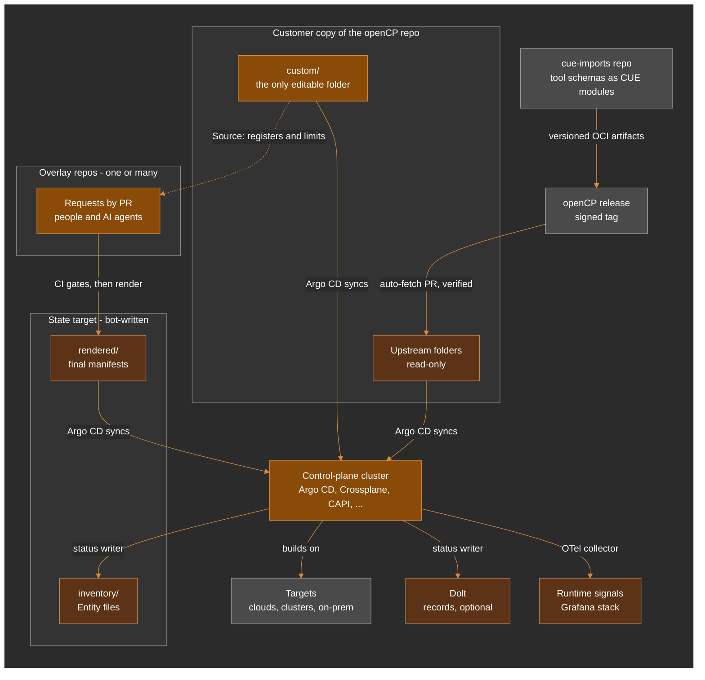
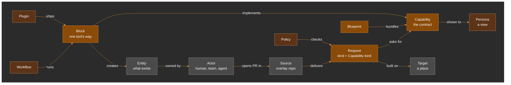
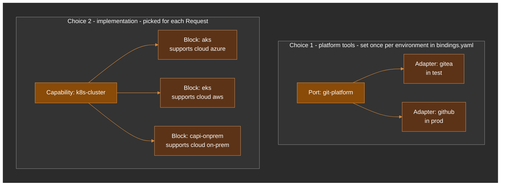
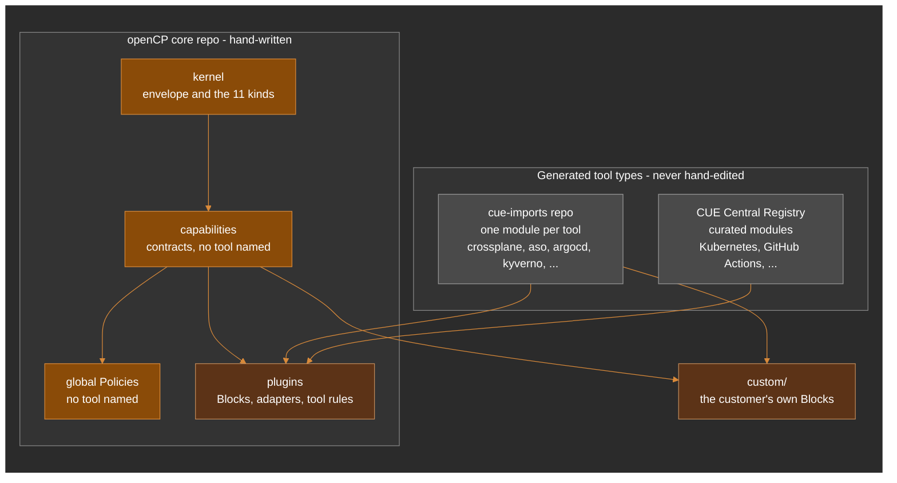
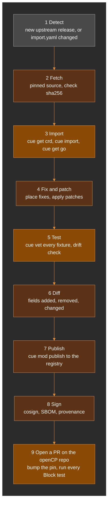
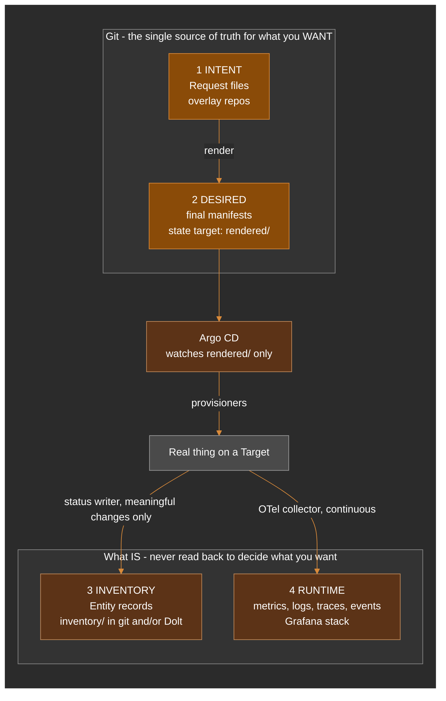
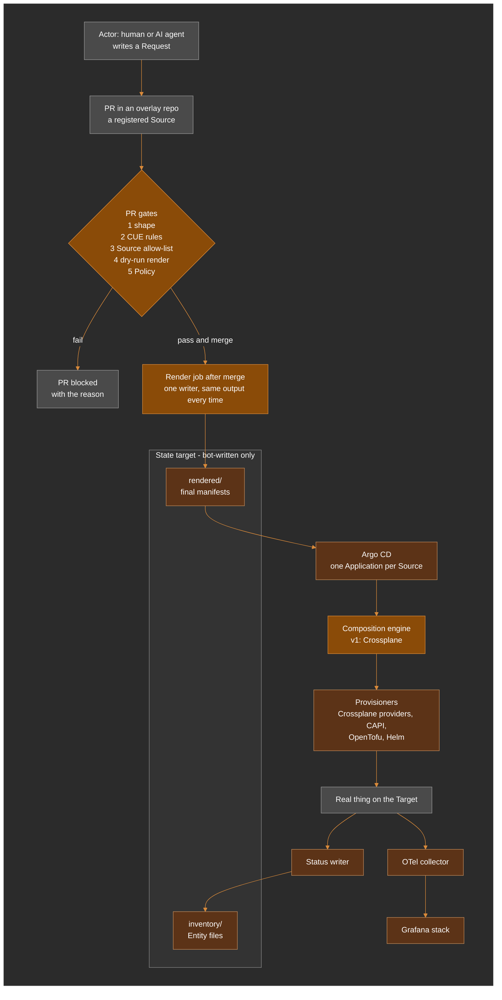
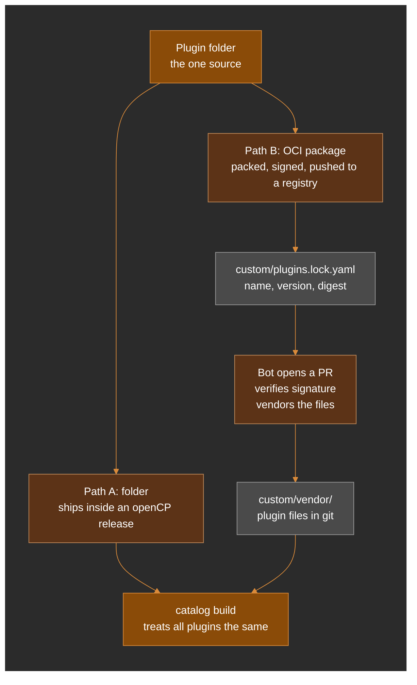

# openCP Service Catalog — Design v5

Status: draft for review. Nothing here is built or run yet. Lines marked `# VERIFY:` need a check against the exact tool version before coding.

**This one file is the whole design.** It replaces my v4 and merges in the four Sonnet v4 docs (`opencp-core-kinds-and-plugins-v4.md`, `opencp-repo-layout-and-delivery-v4.md`, `opencp-state-and-request-flow-v4.md`, `opencp-cue-imports-v4.md`). Section 1 lists what came from where.

---

## 0. Read this first

The whole design in ten lines:

1. The catalog has three parts: a **Menu** (what can be ordered), **Orders** (Requests), and an **Inventory** (what exists).
2. A small fixed **kernel** defines 11 kinds. It names no tool. Everything else is data that plugs in.
3. A **Capability** says *what* ("a Kubernetes cluster"). A **Block** says *how* with one tool ("AKS through Crossplane"). Users only ask for the *what*.
4. A **Request** is a YAML file whose `kind` is the Capability kind. People and AI agents submit it by PR.
5. **Ports and `bindings.yaml`** choose the platform tools (Gitea or GitHub, Tekton or GitHub Actions) per environment.
6. **Actor, Target and Source** say who is asking, where it gets built, and what each overlay repo is allowed to ask for.
7. Schemas are written once in **CUE**. OpenAPI, Crossplane XRDs, docs and agent tool specs are generated.
8. Each tool's own schema is **imported into CUE in a separate repo** and shipped as a signed, versioned CUE module over OCI. Only Blocks use those imports. Contracts never do.
9. A **render step** turns each merged Request into final manifests and stores them in git as **state**. Argo CD applies only what is in state.
10. **Runtime state never flows back into the desired state.** Live signals go to the Grafana stack through OTel. Records of what exists go to flat files and/or Dolt.



**Reading order if you are short on time:** section 0, section 1 (what changed), section 6 (CUE imports), section 8 (worked example), section 18 (decision log).

---

## 1. What changed from v4

### 1.1 Taken from the Sonnet v4 docs

| Added to v5 | Where |
|---|---|
| A real lock file, `cue.lock.yaml`, with four CI checks | 6.9 |
| The render uses only locked modules from the customer's own registry, with no public network | 6.9, 9.3 |
| A per-tool allow-list, so only the kinds a Block needs are imported | 6.5 |
| Known-good sample objects (fixtures) that test every import | 6.5, 6.7 |
| Each import module carries the tool's own license | 6.5 |
| Global Policies added to the "no tool imports" rule | 6.2 |
| A workable v1 answer for how `custom/` adds its own imports | 6.11 |
| A version-bump table for import modules | 6.8 |
| `requiresCue` in the plugin manifest, with two subset checks | 6.10, 14.1 |
| "One tool, several roles" table | 14.4 |
| Delivery in nine steps, and a short "likely doubts" list | 12.6, Appendix A |

### 1.2 Kept from my v4

| Kept | Why it matters |
|---|---|
| `cue get crd` for Kubernetes CRDs | CUE has a command for this. The Sonnet doc marked the CRD path as unknown. |
| Check CUE's Central Registry for a curated module first | Do not import what is already published. |
| `cue mod mirror` for the customer's registry | A command exists for the mirroring step (marked experimental). |
| Blueprint expansion in the render step | One Request can become several final manifests. |
| The full worked example, kept up to date | The Sonnet set still points to the v2 example, which predates state, deletion and imports. |
| One decision log | One numbering, no cross-doc references. |

### 1.3 One correction to my v4

I wrote that a wrong upstream schema can be fixed by a separate CUE file that merges in. That only works for making a schema **stricter**. CUE cannot loosen or correct a rule by merging. v5 has both tools: `fixes/` to tighten, `patches/` to correct (section 6.5).

### 1.4 What is different from v4, at a glance

| Topic | v4 | v5 |
|---|---|---|
| Port for runtime data | One port, `runtime-state`, with Grafana and Dolt adapters | **`telemetry`** for live signals (Grafana through OTel). Dolt is a records store only, under `inventory-store`. |
| Where a tool import is declared | One shared `tools.yaml` | One `import.yaml` per tool |
| Pinning import modules | "In the release manifest" | `cue.mod/module.cue` + `cue.lock.yaml`, checked in CI |
| Plugin manifest field | `imports:` | `requiresCue:` with a minimum version |
| How `custom/` adds imports | Its own nested CUE module | `custom/cue-deps.yaml` and an assembled workspace |
| Publishing openCP's own schemas as CUE modules | Now | Later, after v1 |

**About the port choice.** You did not pick a side, so I went with the one I recommended: the split. Each tool then has one job: Grafana holds signals, Dolt holds records. Dolt keeps its own version history, so status changes over time come for free, and no extra service is needed to push OTel data into Dolt. If you prefer the single `runtime-state` port, it is a small change (open question 1).

---

## 2. The three parts of the catalog

| Part | Plain meaning | Who writes it | Where it lives |
|---|---|---|---|
| **Menu** | What can be ordered | Platform engineers, plugin authors, AI agents (by PR) | Core repo + `custom/` |
| **Order** | A Request: "I want this" | Any persona, or an AI agent | Overlay repo(s) |
| **Inventory** | What exists now and who owns it | Machines only | State target `inventory/`, and/or Dolt |

---

## 3. The kernel: 11 kinds

### 3.1 The fixed envelope

Every object, from any plugin, has the same outer shape:

```
+------------------------------------------------------+
| apiVersion                                           |
| kind                                                 |
| metadata:  name, namespace, owner, labels            |
|  +------------------------------------------------+  |
|  | spec    what you WANT. People and agents. Git. |  |
|  +------------------------------------------------+  |
|  | status  what IS. Machines only. Never in a PR. |  |
|  +------------------------------------------------+  |
+------------------------------------------------------+
```

**References** between objects are typed: `Capability/k8s-cluster`, `Target/azure-dev-scus`, `Actor/team-payments`. A link to something that does not exist fails the PR check.

### 3.2 The kinds

| Group | Kind | Plain meaning | Lives in |
|---|---|---|---|
| **Who** | `Actor` | A human, a team, or an AI agent | `custom/actors/` |
| | `Persona` | A view of the Menu for one type of person | `defaults/personas/`, `custom/personas/` |
| **Where** | `Target` | A place things get built: cloud account, cluster, on-prem site | `custom/targets/` |
| | `Source` | An overlay repo openCP watches, plus what it may ask for | `custom/sources/` |
| **Menu** | `Capability` | The contract. Inputs and outputs. No tool named. | `capabilities/` |
| | `Block` | One tool's way to deliver a Capability | `plugins/*/blocks/` |
| | `Blueprint` | Several Capabilities wired together. A golden path. | `blueprints/` |
| | `Workflow` | Ordered steps, tool-neutral | `workflows/` |
| | `Policy` | A rule, plus how strict it is | `policies/`, `plugins/*/policies/` |
| **Box** | `Plugin` | The shipping box for one tool | `plugins/` |
| **Inventory** | `Entity` | One thing that exists. Machine-written. | Inventory store |

**Three things that are *not* kinds:**

- A **Request** is a file whose `kind` is a Capability kind (`K8sCluster`, `Database`) or a Blueprint kind.
- A **Port** is a named slot in the kernel ("git-platform"). See section 4.
- **`bindings.yaml`** is one config file in `custom/`.

### 3.3 How the kinds connect



---

## 4. How "agnostic" works: two separate choices



### 4.1 Choice 1: ports and bindings

A **port** is a job that needs a tool. An **adapter** is a plugin that does that job. `bindings.yaml` says which adapter is used.

| Port | Job | Adapters (from your tool list) | How many active |
|---|---|---|---|
| `git-platform` | Read repos, open PRs, post checks | gitea, github | One per environment |
| `pipeline-engine` | Run CI | tekton, github-actions, gitea-actions | One per environment |
| `gitops-actuator` | Sync state to the cluster | argocd | One |
| `composition-engine` | Turn a final manifest into resources | crossplane | One |
| `policy-engine` | Check rules | cue (PR time), opa, kyverno (runtime) | Several |
| `inventory-store` | Store records of what exists | git-files, dolt | One or both |
| `telemetry` | Carry live signals out of the cluster | grafana-stack (through OTel) | One |
| `identity` | Resolve Actors to real users and groups | dex | One |
| `secret-store` | Hold secrets by reference | (your choice) | One per environment |
| `workflow-engine` | Long, durable workflows | temporal | One |
| `event-bus` | Events between parts | nats, kafka | One |
| `agent-runtime` | Run AI agents | any MCP client | Several |
| `provisioner` | Create real things | crossplane providers, capi-capz-aso, opentofu, pulumi, ansible, helm | Several |

```yaml
# custom/bindings.yaml
ports:
  git-platform:       {test: gitea, prod: github}
  pipeline-engine:    {default: tekton}
  gitops-actuator:    {default: argocd}
  composition-engine: {default: crossplane}
  policy-engine:      {default: [cue, kyverno]}
  inventory-store:    {default: [git-files]}        # git-files, dolt, or both
  telemetry:          {default: grafana-stack}      # OTel collector -> Grafana stack
provisioners:
  enabled: [crossplane, capi-capz-aso]
blockPreference:                 # only read when two Blocks match one Request
  k8s-cluster: [aks]
state:
  mode: separate-repo            # separate-repo | in-repo
  gitPlatform: github            # which git-platform adapter writes there
  repo: https://github.com/acme/opencp-state
  branch: main
  # in-repo mode instead:
  #   mode: in-repo
  #   path: custom/state/
```

**Rule of thumb for adding a port:** add one only when two tools compete for the same job. Otherwise the tool is just a plugin that gets installed.

**Taskfile is not an adapter. It is the shared layer.** All logic lives in Taskfile targets (`task catalog:build`, `task request:validate`, `task request:render`). Each `pipeline-engine` adapter is a thin wrapper that calls those targets. Adding a CI platform means writing one small wrapper.

### 4.2 Choice 2: which Block serves a Request

This must give the same answer every time. The rule:

1. Take every Block that `implements` the requested Capability.
2. Keep only Blocks whose `supports` matches the Request and its Target (for example `cloud: azure`).
3. Keep only Blocks whose `provisioner` is enabled in `bindings.yaml`.
4. If exactly one is left, use it.
5. If more than one is left, use `blockPreference`. If that does not settle it, **the PR fails** and lists the candidates.
6. If none is left, **the PR fails** and says which condition removed each Block.

No guessing, and no AI in this step.

---

## 5. Schemas: CUE in, OpenAPI out

**Do not hand-write OpenAPI.** Write each schema once in CUE and generate the rest.

| Format | Job | Hand-written? |
|---|---|---|
| CUE | The one source for every schema and rule | Yes |
| YAML | Catalog entries and Requests | Yes, by people or agents |
| OpenAPI v3 | Shape check, editor autocomplete, agent tool specs | No, generated |
| Crossplane XRD | Makes a final manifest a real Kubernetes resource | No, generated |
| Catalog index + docs | What people and agents browse | No, generated |

### Three kinds of rule, three homes

CUE can say more than OpenAPI can. So each rule goes where it can be checked:

| Rule type | Example | Home | Checked where |
|---|---|---|---|
| **Shape** | "`size` is small, medium or large" | `schema.cue` → exported to OpenAPI | Editor, CI, Kubernetes API server |
| **Cross-field** (inside one Request) | "HA is not allowed on size small" | `rules.cue`, not exported | CI |
| **Context** (needs Target, Actor or Source) | "Clusters on a prod Target must be HA" | A `Policy` object | CI on the rendered result, and cluster admission |

### Generated catalog files

- Generated output is **committed in the same PR** as the change that caused it. Reviewers see the real diff.
- CI runs the generator again and **fails if the committed files differ** (drift check).
- Every generated file starts with a `# GENERATED` header.
- Core output lives in `_generated/`. The merged catalog (core + `custom/` + vendored plugins) lives in `custom/_generated/`, because upstream folders are read-only for the customer.

---

## 6. CUE imports: where tool schemas come from and how they ship

### 6.1 Your idea, and the verdict

You want a separate open-source repo that turns each tool's schemas into CUE, releases them as versioned OCI artifacts, and lets the core repo use them.

**Yes, do it.** Three reasons:

- **It is the native CUE way.** CUE modules already ship through OCI registries (`cue mod publish`), so you need no custom format.
- **It keeps the core repo clean.** Imports change when upstream tools change. openCP changes when you decide. Imports are generated and large. They should not share a repo or a release cycle with your contracts.
- **Tool upgrades become compile errors.** When a tool renames a field, every Block that uses it fails in a PR, before anything reaches a cluster.

**One fact that shapes the design:** CUE keeps no lock file and no checksum for dependencies. A dependency is only a minimum version, and the list is worked out again on every run. So openCP adds its own lock file (section 6.9). Without it, the same Request could render differently on two different days.

### 6.2 The layer rule: who may import what

This one table is what keeps the catalog tool-agnostic.

| This code | May import | May **not** import |
|---|---|---|
| Kernel schemas (the 11 kinds) | Nothing from any tool | Any tool module |
| Capability contracts (`K8sCluster`, `Database`) | The kernel | **Any tool module** |
| Global Policies (`policies/`) | Kernel, Capability contracts | Any tool module |
| Blocks (`plugins/*/blocks/`) | Kernel, the contract they implement, **tool modules** | Another plugin's internals |
| Tool rules (`plugins/*/policies/`) | Tool modules | — |
| `custom/` | Everything above, pinned | — |
| A module in the imports repo | Other import modules only | Anything from openCP |

**One sentence to remember:** if a file names a tool, it lives in a plugin. Contracts and global Policies never do. CI enforces this with an import check.

A global Policy checks a Request or a final manifest, so it needs no tool types. A rule about a tool's own objects (for example a rule about Pods) lives in that tool's plugin.



Read the arrows as "is used by". There is **no arrow from the tool types into the kernel, the capabilities or the global Policies.**

### 6.3 "Step 0, then I write schemas and rules, right?"

Not for everything. Only the tool-specific parts wait for imports.

| You are writing | Needs imports first? |
|---|---|
| The 11 kernel kinds | **No** |
| Capability contracts | **No** |
| Global Policies | **No** |
| Request files | **No** |
| **Blocks** (for example "AKS through Crossplane") | **Yes.** The Block's output must match the tool's real schema. |
| **Tool rules** | **Yes** |

So the kernel and the first contract can be written now, while the imports are being built.

**First imports to build** (enough for the `K8sCluster` on AKS slice):

- Crossplane core API types (Composition, XRD, functions).
- The Azure resources your AKS Composition composes. `# VERIFY: whether your prototype uses the Crossplane Azure provider or ASO`
- Argo CD `Application`, `AppProject` and `ApplicationSet`.

### 6.4 Before importing a tool, check what already exists

The CUE Central Registry (`registry.cue.works`) already publishes curated modules for some projects, including Kubernetes and GitHub Actions. Use those where they exist. Your repo fills the gaps. `# VERIFY: which of your tools already have a curated module`

### 6.5 The imports repo

```
cue-imports/                        # VERIFY: final repo name, e.g. opencpdev/cue-imports
├── tools/                          # one folder per tool = one CUE module
│   ├── argocd/
│   │   ├── import.yaml             # what to import: source, version, digest, allow-list
│   │   ├── cue.mod/module.cue      # module path and dependencies
│   │   ├── LICENSE                 # the tool's own license, copied
│   │   ├── fixes/                  # hand-written CUE that TIGHTENS the generated schema
│   │   ├── patches/                # reviewed patches that CORRECT the generated schema
│   │   ├── fixtures/               # known-good sample objects, per tool version
│   │   └── <api-group>/<version>/  # GENERATED packages. Never hand-edited.
│   ├── crossplane/
│   ├── aso/
│   └── ...
├── runner/                         # Taskfile targets: task import:<tool>, test:<tool>, publish:<tool>
├── releases/                       # release notes and the tool-version compatibility table
└── docs/
```

One import is one small file:

```yaml
# tools/argocd/import.yaml
tool: argocd
upstream:
  version: v3.2.0                     # VERIFY: the version you track
  source:
    kind: crd                         # crd | openapi | jsonschema | proto | go
    url: https://github.com/argoproj/argo-cd/...     # VERIFY: the exact release asset
    sha256: "<digest of the source file>"            # the pipeline fails on a mismatch
include:                              # the allow-list: import only what Blocks need
  - group: argoproj.io
    kinds: [Application, AppProject, ApplicationSet]
module:
  path: opencp.dev/imports/argocd@v0  # VERIFY: a name you control
license: Apache-2.0                   # VERIFY: copied from upstream, checked before publishing
```

**Rules for the repo:**

1. **Generated files are never edited by hand.** A change goes into `import.yaml`, `fixes/` or `patches/`.
2. **Same inputs give the same files.** CI regenerates and fails on any difference.
3. **No openCP knowledge in here.** No Capability, no Block, no Policy. Other people can reuse these modules.
4. **Each module carries its upstream license.** Generated schemas are derived from upstream files.
5. **Import only what Blocks need.** Some tools have hundreds of kinds. The allow-list keeps modules small.

**Fixes and patches are two different tools:**

| You need to | Use | How it works |
|---|---|---|
| Make a schema **stricter** (the tool accepts any string, but only three values are valid) | `fixes/` | A small CUE file placed next to the generated one. CUE merges them. The generated file is untouched. |
| **Correct or loosen** a schema (the import got a type wrong) | `patches/` | A reviewed patch applied after the import step. CUE merging cannot do this, because merging can only add rules. |

Prefer a fix. Use a patch only when a fix cannot do the job, and add a fixture that proves why it was needed.

### 6.6 How each kind of source is imported

| The tool publishes | Convert with | Examples from your list |
|---|---|---|
| Kubernetes CRDs | `cue get crd` | Crossplane, CAPI, CAPZ, ASO, Argo CD, Tekton, Kyverno, cert-manager, KEDA |
| An OpenAPI file | `cue import openapi` | Gitea API, GitHub API |
| A JSON Schema | `cue import jsonschema` | Taskfile, Helm chart `values.schema.json` |
| Protobuf files | `cue import proto` | Tools that publish `.proto` files |
| Only Go types | `cue get go` | Tools whose config exists only as Go structs |
| Nothing structured | A small hand-written schema inside the plugin | Bash, Python and Go scripts |

`# VERIFY: the source type for each tool, and each command's flags on your pinned CUE version.`
`# VERIFY: that an imported CRD keeps the meaning of x-kubernetes-preserve-unknown-fields, oneOf and anyOf. Fixtures are how you find out.`

### 6.7 The release pipeline



- Every step is a Taskfile target, so any CI platform can run it.
- Step 5 is what catches a bad import: a real, known-good object from the tool must still pass.
- Step 6 decides the version bump (section 6.8) and writes the release notes.
- Step 9 is what catches a broken Block: the failure is a red PR, not a failed cluster.

This pipeline is also your **dynamic schema generation**. A bot can do step 1 by watching upstream releases. An agent can add a new tool by writing one `import.yaml` in a PR.

### 6.8 Modules, names and versions

**Layout**

- **One module per tool:** `opencp.dev/imports/<tool>@v0`. `# VERIFY: a name you will own`
- **Packages inside mirror the tool's own API groups and versions,** for example `argoproj.io/v1alpha1`. The tool already uses these as its compatibility boundaries, so you inherit them.
- **Not one module for everything.** A Block should load only what it uses, and bumping one tool must not force a bump of another. `# VERIFY: CUE's size limit on a module`

**What CUE requires**

- Versions are `v` plus semver. A module path always ends with a major version (`@v0`, `@v1`).
- CUE picks versions by "minimal version selection": the highest of the minimum versions asked for.

**The module version is not the tool version.** The module version belongs to the imports repo. The tool version it covers is written in `import.yaml`, in the release notes, and in a generated compatibility table.

| Change in the upstream schema | Module version bump |
|---|---|
| Only new optional fields or new kinds | minor |
| A new API version appears (for example `v1beta1`) | minor, as a new package |
| A field is removed, changes type, or becomes required | major. While at `@v0`: a minor bump marked **breaking** in the notes |
| A fix, patch or generator change with no schema change | patch |

**Never delete or re-tag a released version.** A fix is a new version.

### 6.9 Pins, registries and the offline rule

**Two registries**

- **Public copy:** a public OCI registry for the open-source modules.
- **Customer mirror:** each customer copies the modules they use into their own registry, by digest. The onboarding CLI does this. `# VERIFY: cue mod mirror is marked experimental`

```bash
# send openCP modules to the customer mirror, everything else to the public CUE registry
export CUE_REGISTRY=opencp.dev=registry.example.com/cue,registry.cue.works
# VERIFY: the exact repo layout your registry expects
```

`# VERIFY: your registry (Gitea, ACR, GHCR) accepts CUE module artifacts`

**Two pin files**

```cue
// cue.mod/module.cue   (openCP repo root. An upstream file.)
module: "opencp.dev/core@v0"
language: version: "v0.x.y"            // VERIFY: your pinned CUE version
deps: {
	"opencp.dev/imports/argocd@v0": {v: "v0.3.1"}    // CUE's own pin: a MINIMUM version
	"opencp.dev/imports/aso@v0":    {v: "v0.2.0"}
}
```

```yaml
# cue.lock.yaml   (openCP's own file, next to cue.mod/. An upstream file.)
modules:
  - path: opencp.dev/imports/argocd@v0
    version: v0.3.1
    digest: sha256:...                 # the OCI manifest digest
  - path: opencp.dev/imports/aso@v0
    version: v0.2.0
    digest: sha256:...
```

**CI checks on every PR:**

1. Every module CUE resolves has an entry in the lock.
2. The registry's digest for that version matches the lock.
3. The cosign signature on that digest is valid.
4. Nothing is in the lock that is not used.

`# VERIFY: how to list the resolved modules and each one's digest from the registry`

**The offline rule.** The render step and CI read **only** from the customer's mirror. They fail on any module that is not in the lock, and they never reach a public registry. This is what makes the render repeatable, and it makes air-gapped installs work.

**Bumping a module is always a bot PR** in the openCP repo. It:

1. Verifies the new version's signature.
2. Updates `cue.mod/module.cue` and `cue.lock.yaml`.
3. Runs every Block test and the catalog drift check against the new module.
4. Shows the rendered diff, if any final manifest would change.

Customers never pull import modules from the public registry by themselves. A core release carries the pins.

### 6.10 How a Block uses an import

```cue
// plugins/azure-aks/blocks/aks/mapping.cue
package aks

import (
	contract "opencp.dev/core/capabilities/compute/k8scluster"   // the tool-free contract
	aso "opencp.dev/imports/aso/containerservice/v1"             // generated tool types
	// VERIFY: real package paths, and use the tool your Composition actually creates
)

// in:  a final manifest that already passed the gates.
// out: the tool's own object, type-checked against the import.
#Map: {
	in:  contract.#K8sCluster
	out: aso.#ManagedCluster & {
		metadata: name: in.metadata.name
		spec: {
			location:          in.spec.resolved.region
			kubernetesVersion: in.spec.version
		}
	}
}
```

If ASO renames `kubernetesVersion` in a new release, this file stops compiling in the bump PR.

The plugin manifest says which import modules the plugin needs:

```yaml
# plugins/azure-aks/plugin.yaml   (part)
spec:
  requiresCue:
    - module: opencp.dev/imports/aso@v0
      minVersion: v0.2.0
```

CI checks two things: the Block's imports are all listed in `requiresCue`, and everything in `requiresCue` is pinned in `cue.mod/module.cue`. An OCI plugin states its needs the same way.

### 6.11 How `custom/` adds its own imports

The pins live in `cue.mod/module.cue` at the repo root. That is an upstream file, so the customer cannot edit it. Two ways around it:

| Option | How it works | When |
|---|---|---|
| **B. Assemble, then run** | The customer lists extra modules in `custom/cue-deps.yaml`, with digests in `custom/cue.lock.yaml`. `task catalog:build` copies upstream and `custom/` into a temporary workspace, writes a merged `module.cue` there, and runs CUE in it. The merged file is committed under `custom/_generated/` so it can be reviewed. | **v1** |
| **A. Publish core as modules** | Publish the kernel and the Capability contracts as CUE modules. `custom/` becomes its own CUE module that depends on them. | Later |

**B for v1, A later.** B keeps one copy of the core schemas (the customer's repo copy). A would add a second copy in a registry, which then has to be kept in step. A is still worth doing later, because it lets a third-party plugin author build against openCP without cloning it.

`# VERIFY: that option B works end to end on your pinned CUE version`
`# VERIFY: the Sonnet doc notes CUE has a "replace a dependency with a local directory" feature for local development only. I did not re-open that page. It is not a fit for this problem either way.`

---

## 7. State: four kinds, four homes

"State" means four different things. Mixing them is the usual mistake.

| # | Kind | Example | Written by | Home |
|---|---|---|---|---|
| 1 | **Intent** | `payments-dev.yaml`, a K8sCluster Request | People and agents, by PR | Overlay repos (git) |
| 2 | **Desired** | The final manifest for that Request | Render job (bot) | State target, `rendered/` (git) |
| 3 | **Inventory** | An Entity: owner, target, phase, outputs | Status writer (bot) | `inventory-store`: state target `inventory/` (git) and/or Dolt |
| 4 | **Runtime** | Metrics, logs, traces, events | Running components | `telemetry`: Grafana stack through OTel |

**Rule of thumb for where something goes:**

- A person would review it, or an auditor would ask "who asked for this?" → **git**.
- It changes every few seconds → **Grafana stack**.
- It is structured, needs SQL, and you want history and diffs → **Dolt**.



**The one-way rule:** information flows down this picture only. Nothing in Dolt, Grafana or `inventory/` is read to decide the desired state. If a database is lost, nothing that openCP *wants* is lost.

### 7.1 Why keeping final manifests in git is a good idea

This is a known GitOps practice, often called the *rendered manifests pattern*.

- What Argo CD applies is exactly what is in git. Nothing is generated out of sight.
- Every change to the real world is one reviewable diff. Rollback is a git revert.
- Argo CD stays simple. It needs no CUE and no access to the catalog.
- After a new openCP release you can **re-render everything and see the diff before anything changes**.

### 7.2 Where the state target lives

Both options use the same folder layout, so a customer can switch later.

| | **Separate state repo** (default) | **`custom/state/` in the openCP repo** |
|---|---|---|
| Who writes there | The bot only | The bot, people editing `custom/`, and the release PR |
| Repo size | The openCP repo stays small | Grows with every rendered file |
| Write conflicts | None with human PRs | Bot pushes can race with human and release PRs |
| Access control | Its own permissions | Same as the openCP repo |
| Extra setup | One more repo and one bot credential. The onboarding CLI creates both. | Nothing |
| Best for | Production, many teams | Trials, one team, a small fleet |

If you choose `custom/state/`, two guardrails are needed:

1. The platform Argo CD Application that syncs `custom/` must **exclude `custom/state/`**. Otherwise two Applications apply the same resources.
2. A CI check fails any human commit that changes `custom/state/**`. Only the bot identity may.

A variant is a dedicated branch of the openCP repo. It removes the write conflicts, but hides state from the default view of the repo.

**Switching later:** move the two folders, change the `state` block in `bindings.yaml`, and keep the Argo CD Application names unchanged so Argo CD keeps ownership of the live resources. `# VERIFY: Argo CD resource tracking when only an Application's repo URL changes`

### 7.3 The state target layout

```
<state target>/                     # the state repo root, or custom/state/
├── rendered/                       # what Argo CD applies. Argo CD watches ONLY this.
│   └── <source>/<kind>/<name>.yaml
└── inventory/                      # what exists. Only when inventory-store includes git-files.
    ├── <namespace>/<kind>/<name>.yaml
    └── index/                      # generated lookups: by-owner, by-kind, by-target
```

Every render commit carries trace lines, so "who asked for this?" is one `git log` away:

```
render: team-payments/K8sCluster/payments-dev

Opencp-Source: team-payments
Opencp-Request-Repo: https://gitea.example.com/payments/opencp-requests
Opencp-Request-Commit: 4f2a9c1
Opencp-Release: v0.3.1
Opencp-Trigger: request-merged
```

### 7.4 Inventory: flat files and/or Dolt

- A small **status writer** watches Crossplane and Argo CD status and writes the Entity through the `inventory-store` port.
- Two adapters: **`git-files`** (one YAML file per Entity) and **`dolt`** (one row per Entity). Turn on one or both. The Entity schema is the same in both.
- It writes only on **meaningful change**: created, updated, phase changed, deleted.
- It **debounces**: changes in a short window become one write, so a flapping cluster does not make a commit storm.
- Its git commits touch only `inventory/`, separate from render commits.

| | `git-files` | `dolt` |
|---|---|---|
| Needs | Nothing extra | A Dolt database |
| Read by | People, agents, `grep` | SQL: people, agents, dashboards |
| History | Git log | Dolt's own versioned history, with diffs |
| Good for | Small fleets, a full git-native record | Large fleets, fast queries, joins |

Because Dolt versions every change, **"how did this Entity's status change over time" is a Dolt query.** No second store is needed for that.

### 7.5 Runtime signals: OTel to the Grafana stack

| Data | Example | Home |
|---|---|---|
| Time series | CPU, request rate, reconcile duration | Prometheus |
| Logs and events | Controller logs, Kubernetes events, drift events | Loki |
| Traces | Pipeline and render traces | Tempo |

```
 metrics, logs, events, traces
              │
       OTel collector ──► port: telemetry ──► grafana-stack   (Prometheus, Loki, Tempo)
```

- Each Capability's plugin ships its own dashboards and alerts.
- Signals are never written to git, and never to Dolt. Dolt is a SQL database with git-style versions, not a time-series store.

`# VERIFY: which OTel collector receivers read Kubernetes events and custom-resource status`

**How this matches what you asked for.** You said runtime state goes to Dolt, to the Grafana stack through OTel, or to both. In v5 both are there, each with one job:

| You turn on | You get |
|---|---|
| Grafana stack only | Live signals. Records as flat files in git. |
| Dolt only | Records with SQL and history. No live signals. |
| Both | Records in Dolt (and/or git), live signals in Grafana. |

---

## 8. Worked example: request a Kubernetes cluster

This is also the proposed first build slice, because your `XAKSCluster` prototype already has most of it.
The field list below is a sketch. The real contract should come from the fields your prototype XRD already uses.

### 8.1 The contract (in the core repo, imports no tool)

```cue
// capabilities/compute/k8s-cluster/schema.cue
package k8scluster

// The contract. No tool and no cloud is named here.
#K8sCluster: {
	apiVersion: "compute.opencp.dev/v1alpha1"   // VERIFY: final API group and domain
	kind:       "K8sCluster"
	metadata: {
		name:      string
		namespace: string            // the owning team (an Actor of type team)
	}
	spec: {
		target:  string              // a Target reference, e.g. "Target/azure-dev-scus"
		version: string              // Kubernetes version
		size:    *"small" | "medium" | "large"   // * = default the customer may change
		ha:      *false | bool
		private: *true | bool
		// Escape hatch for tool-specific settings.
		// Using it makes this Request non-portable. A Policy can report it.
		extensions?: {...}
		// Filled by the render step. A Request that sets it fails gate 1.
		resolved?: {
			cloud:    string
			region:   string
			env:      string
			block:    string
			deletion: "delete" | "orphan" | "block"
		}
	}
}
```

```cue
// capabilities/compute/k8s-cluster/rules.cue   (CI only, not exported to OpenAPI)
package k8scluster

#K8sCluster: spec: {
	ha: _
	if ha {
		size: "medium" | "large"     // HA is not allowed on size small
	}
}
```

```yaml
# capabilities/compute/k8s-cluster/capability.yaml
apiVersion: catalog.opencp.dev/v1alpha1
kind: Capability
metadata:
  name: k8s-cluster
  owner: Actor/opencp-core
spec:
  title: Kubernetes cluster
  domain: compute
  lifecycle: stable              # experimental | stable | deprecated
  schema: "#K8sCluster"
  outputs: [apiEndpoint, kubeconfigSecretRef]
  visibleTo: [Persona/platform-engineer, Persona/sre]
```

### 8.2 One implementation (in a plugin, uses tool imports)

```yaml
# plugins/azure-aks/blocks/aks/block.yaml
apiVersion: catalog.opencp.dev/v1alpha1
kind: Block
metadata:
  name: aks
spec:
  implements: Capability/k8s-cluster
  supports:
    cloud: [azure]
  provisioner: crossplane
  requires: [Capability/network]
  deletion:
    default: delete              # what happens to the real thing on delete (section 11)
  source: ./composition/         # your existing Composition moves here
  mapping: ./mapping.cue         # typed against the tool import (section 6.10)
```

### 8.3 What the customer's admins set up once (in `custom/`)

```yaml
# custom/actors/team-payments.yaml
apiVersion: catalog.opencp.dev/v1alpha1
kind: Actor
metadata:
  name: team-payments
spec:
  type: team                     # human | team | agent
  identity:
    group: payments-engineers    # resolved by the identity port
```

```yaml
# custom/targets/azure-dev-scus.yaml
apiVersion: catalog.opencp.dev/v1alpha1
kind: Target
metadata:
  name: azure-dev-scus
spec:
  type: cloud-account            # cloud-account | cluster | on-prem-site
  cloud: azure
  region: southcentralus
  env: dev
  credentialsRef: azure-dev-identity   # a reference, never a secret value
```

```yaml
# custom/sources/team-payments.yaml
apiVersion: catalog.opencp.dev/v1alpha1
kind: Source
metadata:
  name: team-payments
spec:
  repo: https://gitea.example.com/payments/opencp-requests   # any git platform
  branch: main
  path: requests/
  allow:                         # the security boundary for this repo
    kinds: [K8sCluster, Database]
    targets: [Target/azure-dev-*]
    namespaces: [team-payments]
    rawManifests: []             # empty = no passthrough (section 9.5)
```

```yaml
# custom/policies/prod-clusters-must-be-ha.yaml
apiVersion: catalog.opencp.dev/v1alpha1
kind: Policy
metadata:
  name: prod-clusters-must-be-ha
spec:
  tier: enforced                 # enforced | default | optional
  appliesTo:
    kinds: [K8sCluster]
    targets: [Target/*-prod-*]
  rule:
    engine: cue                  # cue | opa | kyverno
    ref: ./prod-clusters-must-be-ha.cue
```

### 8.4 Intent: the Request (in the team's overlay repo)

This is all a developer or an agent writes:

```yaml
# requests/payments-dev.yaml
apiVersion: compute.opencp.dev/v1alpha1
kind: K8sCluster
metadata:
  name: payments-dev
  namespace: team-payments
spec:
  target: Target/azure-dev-scus
  version: "1.33"                # VERIFY: use a version your Target supports
  size: small
```

No tool is named. No cloud API is named.

### 8.5 Desired: the final manifest (state target, bot-written)

The same file, with defaults, Target facts, the chosen Block and the deletion mode filled in. This is the file Argo CD applies.

```yaml
# <state target>/rendered/team-payments/k8scluster/payments-dev.yaml
# GENERATED by task request:render. Do not edit.
apiVersion: compute.opencp.dev/v1alpha1
kind: K8sCluster
metadata:
  name: payments-dev
  namespace: team-payments
  annotations:
    opencp.dev/source: team-payments
    opencp.dev/request-path: requests/payments-dev.yaml
    opencp.dev/request-commit: 4f2a9c1
    opencp.dev/release: v0.3.1
spec:
  target: Target/azure-dev-scus
  version: "1.33"
  size: small
  ha: false                      # default
  private: true                  # default
  resolved:                      # filled by the render step
    cloud: azure
    region: southcentralus
    env: dev
    block: aks
    deletion: delete
    # VERIFY: how `block` maps to Crossplane's composition selection fields
```

### 8.6 Inventory: the Entity (machine-written)

```yaml
# <state target>/inventory/team-payments/k8scluster/payments-dev.yaml   (git-files adapter)
# GENERATED by the status writer. Do not edit.
apiVersion: catalog.opencp.dev/v1alpha1
kind: Entity
metadata:
  name: payments-dev
  namespace: team-payments
  owner: Actor/team-payments
spec:
  kind: K8sCluster
  target: Target/azure-dev-scus
  request:
    source: Source/team-payments
    path: requests/payments-dev.yaml
    commit: 4f2a9c1
  deliveredBy: Block/aks
status:
  phase: ready                   # provisioning | ready | failed | deleting | orphaned
  outputs:
    apiEndpoint: "..."
    kubeconfigSecretRef: payments-dev-kubeconfig
  lastChanged: "2026-11-19T18:00:00Z"
```

```
# dolt adapter: the same Entity as one row in table `entities`
namespace      | kind       | name         | owner         | target         | block | phase | last_changed
team-payments  | K8sCluster | payments-dev | team-payments | azure-dev-scus | aks   | ready | 2026-11-19 18:00
```

Detailed health ("node pool 2 is degraded", CPU, events) is **runtime** state. It goes to Grafana, not into this record.

### 8.7 Generating OpenAPI and the XRD

```bash
# VERIFY: flags against your pinned CUE version
cue def ./capabilities/compute/k8s-cluster/schema.cue \
  -o _generated/openapi/k8s-cluster.yaml --out openapi+yaml
```

```yaml
# _generated/xrd/k8s-cluster.yaml   # GENERATED
apiVersion: apiextensions.crossplane.io/v2    # VERIFY: against your Crossplane version
kind: CompositeResourceDefinition
metadata:
  name: k8sclusters.compute.opencp.dev
spec:
  scope: Namespaced
  group: compute.opencp.dev
  names: {kind: K8sCluster, plural: k8sclusters}
  versions:
    - name: v1alpha1
      served: true
      referenceable: true
      schema:
        openAPIV3Schema: {}      # filled from the CUE export
                                 # VERIFY: Kubernetes needs the "structural" form (no $ref)
```

This flips your prototype's `policy/` folder ("CUE mirror of the XRD"). CUE becomes the source and the XRD is generated, so there is only one copy to keep right.

---

## 9. The Request flow and the render step

### 9.1 The whole flow



### 9.2 The five gates (before merge)

| Gate | Question | Fails when |
|---|---|---|
| 1. Shape | Does the YAML match the schema? | Wrong type, unknown field, missing required field, or `resolved` set by hand |
| 2. CUE rules | Do the fields agree with each other? | `ha: true` with `size: small` |
| 3. Source allow-list | May this repo ask for this? | Kind, Target or namespace is outside the Source's `allow` |
| 4. Dry-run render | Do references resolve, and does exactly one Block match? | Unknown Target, no Block, or two Blocks with no preference |
| 5. Policy | Do org rules pass on the rendered result? | An `enforced` Policy fails |

The PR shows the dry-run result as a comment, so the author sees the exact final manifests before merge.

### 9.3 The render step: the "behind the scenes magic"

One Taskfile target, `task request:render`. The same code runs as the dry run in the PR (gate 4) and for real after merge, so they cannot disagree.

| Step | What it does |
|---|---|
| 1. **Read** | Load the Request and find its Source. |
| 2. **Resolve** | Look up every reference: Target, Actor, other objects. |
| 3. **Expand** | If the Request is a Blueprint, split it into one part per Capability, in dependency order. |
| 4. **Pick** | Choose exactly one Block for each part (the rule in 4.2). |
| 5. **Fill** | Add defaults, Target facts, the chosen Block and the deletion mode. Link parts to each other **by reference**, never by value. |
| 6. **Write** | Write one final manifest per part into `rendered/`, each with its trace annotations. |

A Blueprint shows steps 3 to 5 best. One Request in, three final manifests out:

```
Request (overlay repo)                Final manifests (state target)
----------------------                -----------------------------------------
kind: WebService          expand      rendered/team-payments/
name: checkout          --------->    ├── workload/checkout.yaml       block: k8s-deployment
                          pick        ├── database/checkout-db.yaml    block: azure-postgres-flexible
                          fill        └── dnsrecord/checkout.yaml      block: external-dns
                                          (workload points at the database's secretRef by name.
                                           The value is resolved in the cluster, at runtime.)
```

**Rules for the render step:**

1. **Same inputs, same bytes.** No clocks, no random values, sorted keys. A re-render with no real change makes **no commit**.
2. **One writer per state target.** Renders run one at a time, in a queue. On a push conflict: fetch, re-apply, push again.
3. **One commit per trigger,** with the trace lines from 7.3.
4. **It never reads `inventory/` or runtime state.**
5. **Secrets are references only.** A scan step fails the render if it finds a secret value.
6. **No AI inside the render.** Agents work before it (they write the Request) and after a failure (they explain the error and propose a fix as a new commit).
7. **Locked inputs only.** It uses only CUE modules listed in `cue.lock.yaml`, read from the customer's registry mirror. It fails on an unlocked module and never reaches a public registry (section 6.9).

### 9.4 What triggers a render, and where it runs

| Event | What is re-rendered | How state is updated |
|---|---|---|
| A Request is merged or changed | That Request | Bot commits directly. The PR preview was already reviewed. |
| A Request file is deleted | Its final manifest is removed, after the delete check (section 11) | Same |
| A release PR merges | Everything in v1. Later, only what the changed Blocks and schemas touch. | The release PR shows the diff first (section 13) |
| `custom/` changes (bindings, Target, Policy, own Block) | Everything that references it. Everything in v1. | The `custom/` PR shows the diff first |
| Scheduled drift check finds a difference | The files that differ | Alert, plus a PR that puts state back |

**Where it runs: centrally, in the control-plane cluster.** Each Source sends a webhook. The `pipeline-engine` adapter (Tekton in v1) runs the validate and render targets. The `git-platform` adapter posts the PR checks.

- Overlay repos need **no pipeline files**.
- There is one place for the bot credential.

The alternative is a pipeline in each overlay repo that calls the shared task. A different `pipeline-engine` adapter can do that without changing anything else.

### 9.5 Passthrough: "or takes the PR as a direct manifest"

Some people will submit a ready-made Kubernetes or Crossplane manifest instead of a Request.

- **Off by default.** A Source turns it on, kind by kind, in `allow.rawManifests` (for example `[apps/v1/Deployment]`).
- The file skips the Capability and Block steps, but **still passes the allow-list and Policy gates**.
- It is copied to `rendered/` unchanged, with the same annotations and trace lines.

A raw manifest names the tool and cloud directly, so it is **not portable**. A Policy can report it, the same way it reports `extensions`.

### 9.6 How final is "final"?

| Level | What is in `rendered/` | Who does the last expansion |
|---|---|---|
| **A. Request level** (proposed for v1) | The Request with everything decided: defaults, Target facts, chosen Block | The composition engine, inside the cluster |
| **B. Fully expanded** | Every low-level resource (each Azure resource, each Kubernetes object) | Nobody. Git has it all. |

Why A for v1:

- A Block often needs values that only exist in the cluster, such as an ID that Azure returns.
- Full expansion in CI repeats work the composition engine already does, so the same logic lives in two places.
- State stays small and readable.

The PR comment can still preview the full expansion. `# VERIFY: Crossplane's render command for previewing a Composition outside the cluster`

Blocks that are plain templates (Helm, Kustomize) could be stored fully expanded later. The layout already allows it.

### 9.7 How a final manifest runs in v1

In v1 every Block is wrapped as a Crossplane Composition, and the final manifest is a Crossplane composite resource. Crossplane v2 can compose any Kubernetes resource, so a Block can drive other tools from inside its Composition: CAPI objects, a Helm release, a Tekton run, or an OpenTofu workspace. `# VERIFY: which controller you use for OpenTofu and Helm from inside a Composition`

---

## 10. Argo CD wiring

### 10.1 One Application per Source

An ApplicationSet creates one Application per `rendered/<source>/` folder. Each one gets its own AppProject, limited to that Source's namespaces and kinds. This is the runtime half of the allow-list. Gate 3 is the PR-time half.

```yaml
# generated from custom/sources/*.yaml by `task catalog:build`
apiVersion: argoproj.io/v1alpha1
kind: ApplicationSet
metadata:
  name: opencp-rendered
  namespace: argocd
spec:
  goTemplate: true
  generators:
    - git:
        repoURL: https://github.com/acme/opencp-state     # from bindings.yaml
        revision: main
        directories:
          - path: rendered/*
  template:
    metadata:
      name: 'rendered-{{.path.basename}}'
      annotations:
        argocd.argoproj.io/manifest-generate-paths: '.'    # VERIFY
    spec:
      project: 'source-{{.path.basename}}'
      source:
        repoURL: https://github.com/acme/opencp-state
        targetRevision: main
        path: '{{.path.path}}'
      destination:
        server: https://kubernetes.default.svc
      syncPolicy:
        automated: {prune: true, selfHeal: true}           # read section 11 before using prune
```

`# VERIFY: ApplicationSet git directory generator fields on your Argo CD version.`
`# VERIFY: AppProject fields for limiting destinations and resource kinds.`

### 10.2 Never watch what you also write

| Writer | Writes to | What it triggers |
|---|---|---|
| Render job | `rendered/` | Argo CD sync of that Source's Application only |
| Status writer | `inventory/` | Nothing. Argo CD does not watch it, and the render job never reads it. |
| People | Never touch the state target | Nothing |
| Release auto-fetch | Upstream folders in the openCP repo | A release PR, then a re-render |

The render job starts only from **Source, release or `custom/` events**, never from a push to the state target. That breaks every possible loop.

### 10.3 Speed

- Use git **webhooks** to Argo CD so you are not waiting for the polling interval. `# VERIFY: Argo CD refresh interval and webhook setup`
- Final manifests are plain YAML, so Argo CD does no heavy rendering at sync time.

### 10.4 Argo CD's built-in "source hydrator"

Argo CD has its own feature that renders manifests, pushes them to git, and syncs them. The earlier state doc recorded it as beta, off by default, and git only. I could not re-open that page in this session, so treat those three facts as unchecked. `# VERIFY`

I would **not use it in v1**. openCP's render needs custom logic (CUE, Target facts, Source allow-lists, Policy) and a second writer (the status writer) on the same target. Revisit it later.

---

## 11. Deleting things safely

This is the most dangerous moment in the whole flow.

```
Request file deleted → final manifest removed → Argo CD prunes the resource
        → Crossplane deletes the real cloud resource (by default)
```

**Three deletion modes**, written by the render step into `spec.resolved.deletion`:

| Mode | What happens to the real thing | Default for |
|---|---|---|
| `delete` | Deleted | dev and test Targets |
| `orphan` | **Kept.** The Entity is marked `orphaned` so it stays visible. | Stateful kinds (databases, storage) on prod Targets |
| `block` | The deletion PR **fails** unless a named Actor group approves | Production clusters |

The mode comes from the Block's default, and a Policy can make it stricter:

```yaml
# custom/policies/deletion-protection-prod.yaml
apiVersion: catalog.opencp.dev/v1alpha1
kind: Policy
metadata:
  name: deletion-protection-prod
spec:
  tier: enforced
  appliesTo:
    kinds: [K8sCluster, Database]
    targets: [Target/*-prod-*]
  rule:
    engine: cue
    ref: ./deletion-protection.cue    # mode: block. Needs approval from Actor/platform-admins
```

The Block's Composition turns `orphan` into Crossplane's management policy without the delete action, so Crossplane keeps the external resource when the Kubernetes object goes away.
`# VERIFY: how a Composition sets managementPolicies on composed resources, and that your provider versions honour it`

One more guard: the render job **never deletes more than one Source's files in a single commit**, unless the trigger is an explicit "remove Source" PR. A bug cannot then empty the whole `rendered/` tree.

---

## 12. Where things live

### 12.1 All the repos

| Repo | Holds | Who writes |
|---|---|---|
| `cue-imports` (upstream, open source) | Tool schemas as signed CUE modules, published to an OCI registry | Its pipeline only. Customers use a mirrored copy. |
| `opencp` (upstream) | The product | openCP maintainers |
| `opencp` (customer copy) | Upstream release + `custom/` | Auto-fetch pipeline; customer edits `custom/` |
| `onboarding-prereqs` | Bootstrap CLI and cluster build | openCP maintainers; customer keeps a private copy |
| Overlay repo(s) | Requests. One shared repo or one per team. | Any Actor, by PR |
| State repo (default) | `rendered/` and `inventory/`. Or `custom/state/` in the openCP copy. | openCP bot only |

### 12.2 The core repo

```
opencp/
├── cue.mod/module.cue       # minimum versions of the tool import modules this release uses
├── cue.lock.yaml            # OCI digests for those modules. CI verifies them.
├── kernel/                  # the small fixed model. Names NO tool. Imports NO tool module.
│   ├── schema/              #   CUE: envelope, references, the 11 kinds
│   ├── ports/               #   port definitions (one small contract each)
│   └── tools/               #   catalog build, validate, render, lint
├── capabilities/            # the contracts, grouped by domain. Imports NO tool module.
│   ├── compute/             #   k8s-cluster, workload, vm, gpu-job
│   ├── data/                #   database, cache, object-store, message-bus
│   ├── network/             #   ingress, dns-record, certificate, mesh-policy
│   ├── delivery/            #   pipeline, release, environment
│   ├── security/
│   ├── observability/
│   └── ai/                  #   llm-endpoint, agent, training-job
├── plugins/                 # one flat folder per tool = one Lego box. May import tool modules.
├── blueprints/              # golden paths
├── workflows/               # tool-neutral workflows
├── policies/                # global rules. Your 10 categories fit as-is.
├── defaults/                # default bindings, enabled plugins, personas, tool settings
├── agents/                  # agent definitions, skills, MCP tool definitions, evals
├── interfaces/              # CLI and MCP server
├── runtime/                 # what Argo CD installs on the control-plane cluster
├── releases/                # release manifest: versions, digests (plugins AND import modules),
│                            #   checksums, SBOM, provenance
├── _generated/              # core output. Committed. Never hand-edited.
├── tests/
├── docs/
└── custom/                  # THE ONLY FOLDER CUSTOMERS EDIT
```

### 12.3 One plugin folder

```
plugins/azure-aks/
├── plugin.yaml              # the manifest. The only required file.
├── install/                 # how the tool gets onto the control-plane cluster
├── adapters/                # port implementations (if it fills a port)
├── blocks/                  # Blocks (if it implements Capabilities)
│   └── aks/
│       ├── block.yaml
│       ├── mapping.cue      #   typed against the tool import module
│       └── composition/
├── capabilities/            # new contracts (only if core has none that fit)
├── policies/                # rules specific to this tool
├── observability/           # dashboards, alerts
├── tests/
└── docs/                    # human docs + hints for agents
```

### 12.4 The `custom/` folder

```
custom/
├── cue-deps.yaml            # extra CUE modules the customer needs (section 6.11)
├── cue.lock.yaml            # digests for those extra modules
├── bindings.yaml            # port -> adapter per environment, block preference, state target
├── enabled-plugins.yaml     # which plugins this org turns on
├── plugins.lock.yaml        # OCI plugins to pull, pinned by digest
├── vendor/                  # OCI plugin files, added by bot PR
├── actors/                  # humans, teams, agents
├── personas/                # org-specific views
├── targets/                 # cloud accounts, clusters, on-prem sites
├── sources/                 # the registered overlay repos
├── capabilities/            # customer's own contracts   (same layout as core)
├── plugins/                 # customer's own plugins
├── blueprints/
├── workflows/
├── policies/                # may add rules. May not weaken an `enforced` rule.
├── overrides/               # values for upstream defaults
├── _generated/              # the merged catalog the cluster uses
└── state/                   # BOT-WRITTEN ONLY. Present only when state.mode is "in-repo".
    ├── rendered/
    └── inventory/
```

### 12.5 Where your current folders go

| Your draft | Goes to | Why |
|---|---|---|
| `IDP` | not a folder | The IDP is the catalog + `agents/` + `interfaces/`. |
| `GitOps` | `runtime/` + `plugins/argocd/` | What Argo CD installs, and Argo CD itself. |
| `CI`, `CD` | `workflows/` + `plugins/tekton/`, `plugins/github-actions/`, `plugins/gitea-actions/` | Workflows are neutral. Each CI platform is a plugin. |
| `policies/` | `policies/` + `plugins/*/policies/` | Global rules vs tool-specific rules. |
| `observability` | `capabilities/observability/` + plugins (grafana, loki, tempo, otel) | Contract vs tool. |
| `defaults/` | `defaults/` | Same. |
| `release-version-references` | `releases/` | Same. |
| `agents` | `agents/` | Same. |
| `custom/` | `custom/` | Same, with the layout in 12.4. |
| `(blank branch)` | not needed | A new plugin is a new folder. Nothing to reserve. |
| `platform/01-azure-foundation/` (image) | `onboarding-prereqs` repo | Must exist before openCP runs. |
| `platform/02-install-platform/` (image) | `onboarding-prereqs` (seed Argo CD only) + `plugins/*/install/` | Argo CD is seeded first, then it installs the rest. `# VERIFY: sync order for cert-manager, CAPI/CAPZ, Crossplane` |
| `platform/03-configure-platform/` (image) | `defaults/` + `custom/` | Customer values go to `custom/`, never upstream. |
| `platform/crossplane/` (image) | `plugins/azure-aks/blocks/` + `_generated/xrd/` | The Composition is a Block. The XRD is generated. |
| `addons/` (image) | `plugins/<tool>/` | One folder per tool. |
| `clusters/` (image) | `tests/fixtures/` + `docs/examples/` | Real Requests live in overlay repos. |
| `policy/` CUE mirror (image) | `capabilities/compute/k8s-cluster/` + `policies/` | CUE becomes the source, not a mirror. |
| `tests/` (image) | `plugins/azure-aks/tests/` + top-level `tests/` | Build-check-delete with the plugin. Load tests at the top. |
| `config/` (image) | `defaults/` + `custom/overrides/` | Secret references only, never values. |
| `tools/` (image) | `kernel/tools/` | Same. |

### 12.6 Delivery in nine steps

```
1  Global admin runs the onboarding CLI            (opencpdev/onboarding-prereqs)
2  CLI builds the control-plane cluster            (v1 = Azure AKS) and seeds Argo CD
3  Admin keeps the onboarding code in a private repo, for later updates
4  Admin fetches an openCP release tag into a repo on the customer's own git platform
5  That repo gets the auto-fetch pipeline for future releases
6  CLI mirrors the pinned CUE modules and plugins into the customer's registry
7  Admin picks the state target                    (separate repo, or custom/state/)
8  Admin registers overlay repos as Sources        (custom/sources/)
9  Teams open Request PRs. openCP renders, applies and reports.
```

The release already carries the pinned CUE module versions, so the admin never touches the imports repo.

---

## 13. Releases: how "only `custom/` is editable" is enforced

1. **The auto-fetch pipeline opens a PR. It never pushes.** Admins and CI see the change before merge.
2. **It verifies the release** before opening the PR: signature, digests and provenance from `releases/`. That includes the digest and signature of every CUE import module in `cue.lock.yaml`.
3. **CI proves upstream folders are untouched.** Each release ships a checksum list. CI fails if any file outside `custom/` differs from it. Only the auto-fetch pipeline may change those files.
4. **CI re-checks the customer's content against the new schemas** in the same PR: all of `custom/`, and every Request in every Source.
5. **CI does a dry re-render and comments the result:** "N final manifests would change", with the diff. Reviewers see the blast radius of an upgrade before it merges.
6. **One-way dependency.** `custom/` and overlay repos point to upstream objects. Upstream never points back.

**Policy tiers** decide what a customer may change:

| Tier | Customer may |
|---|---|
| `enforced` | Add stricter rules. Never switch it off or weaken it. |
| `default` | Change the value in `custom/overrides/`. |
| `optional` | Turn it on or off. |

---

## 14. Plugins

### 14.1 The manifest

```yaml
# plugins/azure-aks/plugin.yaml
apiVersion: catalog.opencp.dev/v1alpha1
kind: Plugin
metadata:
  name: azure-aks
  version: 0.1.0                 # the plugin's own version (semver)
  owner: Actor/opencp-core
spec:
  lifecycle: experimental
  requiresKernel: ">=0.1 <1.0"   # catalog build rejects a mismatch
  dependsOn: [crossplane]        # other plugins it needs
  requiresCue:                   # tool import modules its Blocks are typed against
    - {module: "opencp.dev/imports/aso@v0", minVersion: v0.2.0}   # VERIFY: final module path
  provides:                      # one tool can play several roles
    install: false               #   does it install a tool on the cluster?
    adapters: []                 #   ports it fills, e.g. [git-platform]
    blocks:
      - name: aks
        implements: Capability/k8s-cluster
    capabilities: []             #   new contracts it adds
  permissions:                   # what this plugin may touch
    namespaces: [opencp-azure]
    apiGroups: [compute.opencp.dev]
```

### 14.2 Plugin rules

1. A plugin can only **add**. It never edits the kernel or another plugin's files.
2. Plugins talk to each other only through **ports** and **typed references**.
3. Every kind a plugin adds lives in the plugin's own API group.
4. Every plugin ships tests, written first.

### 14.3 Delivery: one source, two ways to ship

A plugin is always authored as a **folder**. The OCI package is that same folder, packed and signed.



| Path | Used for |
|---|---|
| **A. Folder** | The plugins every install needs. They arrive with the release tag. |
| **B. OCI package** | Optional add-ons, third-party plugins, a customer's shared plugins, and updating one plugin without waiting for a full release. |

An OCI pull is always a PR, so git stays the full source of truth and the registry is only transport:

```yaml
# custom/plugins.lock.yaml
plugins:
  - name: litmus-chaos
    source: oci://registry.example.com/opencp-plugins/litmus-chaos   # VERIFY: registry path
    version: 1.2.0
    digest: sha256:...           # pinned by digest, never by tag alone
```

**Everything that ships through a registry follows the same four rules,** whether it is a plugin or a CUE import module:

| Need | Standard |
|---|---|
| Package format | OCI artifact, in any OCI registry |
| Signing | Sigstore cosign |
| Contents list | SBOM attached to the package |
| Build proof | SLSA provenance attached to the package |

### 14.4 One tool, several roles

| Plugin | Installs the tool? | Adapters | Blocks |
|---|---|---|---|
| `crossplane` | yes | `composition-engine`, `provisioner` | none |
| `gitea` | yes (test) | `git-platform` | none |
| `azure-aks` | no | none | `aks` for `K8sCluster` |
| `grafana-stack` | yes | `telemetry` | observability Capabilities |
| `dolt` | yes | `inventory-store` | none |

This is why a plugin is one flat folder with a `provides` list, and not one folder per plugin type.

---

## 15. Content made by scripts or AI agents

| You want | How it works |
|---|---|
| **Dynamic catalog** | `task catalog:build` walks every folder, validates each item against the kernel, and writes the index. Nobody keeps a list by hand. |
| **Dynamic schemas for a new tool** | One `import.yaml` file in the imports repo. The pipeline in section 6.7 does the rest. |
| **A draft Block for a new tool** | An agent reads the new import module and a Capability, and proposes the `mapping.cue`. CUE checks both ends of the mapping. |
| **AI-built Blueprints** | Every Block states `implements`, `requires` and `supports`. An agent reads the index, matches "requires" to "implements", and proposes a Blueprint. |
| **AI-built Workflows** | Same idea. Steps reference Blocks. |
| **AI-written Requests** | An agent reads the generated tool specs, writes the Request YAML, and opens the PR for a person. |

**One rule covers all of it.** An agent is an `Actor`. It only writes files into a PR. It never talks to the cluster and never writes to the state target. Its PR passes the same gates as a person's. Anything a script or agent made carries a provenance header:

```yaml
# GENERATED
# by: Actor/catalog-builder-agent
# from: opencp.dev/imports/traefik@v0
# at: 2026-11-19
```

---

## 16. Security, audit, and what can go wrong

**The state target is a production key.** Whoever can push there can change real infrastructure, limited only by each Source's AppProject.

1. Only the bot identity can write. Everyone else is read-only.
2. Short-lived tokens through the `git-platform` adapter (for example a GitHub App).
3. Branch protection on the state branch.
4. Signed render commits, and Argo CD verifying the signature. `# VERIFY: Argo CD commit signature verification options`
5. One AppProject per Source, so a mistake in one Source cannot touch another's namespaces.

**The audit chain.** Each link is a git object or an Argo CD record:

```
Request commit ─► PR approvals ─► Render commit ─► Argo CD sync ─► Provisioner events ─► Entity history
 (who asked)      (who approved)  (what was applied) (when applied)  (what happened)      (current state)
```

**What can go wrong:**

| Failure | What happens | Guard |
|---|---|---|
| Render fails after merge | The state target is unchanged. The job comments on the merged PR and alerts. | Gates run the same code, so this is rare. |
| Someone hand-edits state | The scheduled drift check finds it. | Bot-only writes, branch protection. |
| A secret value in a final manifest | The render fails. | References only, plus a scan step. |
| Two merges at once | The queue runs them one at a time. | Single writer. |
| State repo is unreachable | No new changes apply. | Existing resources keep running. |
| Argo CD is down | Nothing new applies. | Git is unaffected. Re-sync when it is back. |
| Bot token leaks | Attacker can change the state target. | AppProjects, short-lived tokens, signed commits. |
| A tool import changes under you | Blocks fail to compile in the bump PR. | Digest lock, signature check, and bumps only by bot PR. |
| An import cannot express part of a tool's schema | A fixture fails in the imports repo. | Reviewed fixes and patches, with a fixture for each. |
| A tool's license does not allow redistribution | The module is not published. | License copied and checked per module. |
| Public registry is down | Nothing, for customers. | They build from their own mirrored registry. |
| Cluster lost | Rebuild: seed Argo CD, point it at the state target. | Desired state is fully in git. |

---

## 17. Your tools, mapped

| Tool | Role in openCP |
|---|---|
| CUE | Schema source, tool imports, Block mappings, the render step, and `policy-engine` at PR time |
| Gitea, GitHub | Adapter for `git-platform` |
| Tekton, GitHub Actions, Gitea Actions | Adapter for `pipeline-engine` |
| Taskfile | The shared task layer every CI adapter calls |
| Argo CD | Adapter for `gitops-actuator`. Watches `rendered/` only. |
| Crossplane | Adapter for `composition-engine`, and a `provisioner` |
| CAPI + CAPZ + ASO, Terraform/OpenTofu, Pulumi, Ansible, Helm, Kustomize | `provisioner` used by Blocks |
| Bash, Python, Go scripts | Steps inside a Workflow |
| OPA, Kyverno | `policy-engine` at runtime |
| OTel collector | Adapter for `telemetry`: carries runtime signals out of the cluster |
| Grafana, Prometheus, Loki, Tempo | Where runtime signals land (`grafana-stack`). Also plugins with Blocks for the observability Capabilities. |
| Dolt | Adapter for `inventory-store`: records of what exists, with history |
| Temporal | Adapter for `workflow-engine` |
| NATS, Kafka | Adapter for `event-bus` |
| dex | Adapter for `identity` |
| Karmada | Plugin with Blocks for multi-cluster placement |
| Trivy | Plugin: a scan step for Workflows, plus Policies |
| Linkerd, Traefik, KEDA, cert-manager, External-DNS, Longhorn, OpenEBS, RustFS, Litmus, Paralus, descheduler | Plugins that install the tool and ship its Blocks |
| Business databases (cloud or on-prem) | Blocks that implement `Capability/database` |

---

## 18. Decision log

"You" = decided by you. "Proposed" = my proposal, needs your review.

**Catalog model**

| ID | Decision | Why | Status |
|---|---|---|---|
| DL-1 | The catalog has three parts: Menu, Order, Inventory. | Each has a different writer and lifetime. | Proposed |
| DL-2 | A small fixed kernel with 11 kinds. It names no tool. | The only way "add any CNCF tool" stays true. | Proposed |
| DL-3 | Every object uses the Kubernetes-style envelope. `spec` is in git. `status` is machine-written only. | Argo CD, Crossplane, kubectl and agents already understand it. | Proposed |
| DL-4 | References are typed (`Kind/name`). A broken link fails the PR. | No free-text links. | Proposed |
| DL-5 | CUE is the only hand-written schema. OpenAPI and XRDs are generated, committed, and drift-checked. | One source. Reviewable diffs. | Proposed |
| DL-6 | Shape rules in `schema.cue`, cross-field rules in `rules.cue`, context rules as `Policy`. | Each rule lives where it can be checked. | Proposed |
| DL-7 | Capability (what) is separate from Block (how). | Tool, cloud and on-prem agnostic. | Proposed |
| DL-8 | A Request's `kind` is the Capability or Blueprint kind. No wrapper. | Simple, Kubernetes-native, best autocomplete. | **You** |
| DL-9 | Platform tools are chosen through ports and `custom/bindings.yaml`. | Gitea in test and GitHub in prod with no plugin change. | Proposed |
| DL-10 | Block choice is rule-based. Exactly one Block must match, or the PR fails. | Same answer every time. | Proposed |
| DL-11 | `Actor`, `Target` and `Persona` are real objects. | Ownership, placement and views can be checked, not guessed. | Proposed |
| DL-12 | Every overlay repo is registered as a `Source` with an allow-list, checked in CI and at runtime. | Mono and multi repo both work. It is the security boundary. | Proposed |

**CUE imports**

| ID | Decision | Why | Status |
|---|---|---|---|
| DL-13 | Tool schemas are imported into CUE in a separate open-source repo and released as versioned OCI artifacts. | Keeps the core repo clean. Tools change on their own schedule. | **You** |
| DL-14 | The artifacts are CUE modules (`cue mod publish`). One module per tool. Packages mirror the tool's API groups. The module version is separate from the tool version. | No custom format. No version confusion. | Proposed |
| DL-15 | Layer rule: kernel, Capability contracts and global Policies never import a tool module. Only Blocks and tool rules do. CI enforces it. | A contract that imports tool types is not agnostic. | Proposed |
| DL-16 | The imports repo holds only generated files, fixes, patches and fixtures. No openCP knowledge. Each module carries the tool's license. | Reusable by others. Rules are reviewed with the Blocks. | Proposed |
| DL-17 | Each tool has an allow-list of what to import. | Some tool schemas are huge. | Proposed |
| DL-18 | Use the CUE Central Registry's curated modules where they exist. | Do not redo published work. | Proposed |
| DL-19 | Pins are `cue.mod/module.cue` (minimum version) plus `cue.lock.yaml` (OCI digest). CI checks both and the signature. | CUE itself keeps no lock or checksum. | Proposed |
| DL-20 | The render and CI read only from the customer's registry mirror, and fail on an unlocked module. | Repeatable renders. Air-gapped installs. | Proposed |
| DL-21 | Every module release is tested with fixtures and signed, with SBOM and provenance. An upstream release opens a PR by itself. A bump is a bot PR that runs every Block test. | A bad bump fails in a PR, not in production. | Proposed |
| DL-22 | `plugin.yaml` lists the import modules it needs in `requiresCue`. | Plugins state their needs. CI can check them. | Proposed |
| DL-23 | In v1, `custom/` adds imports through `custom/cue-deps.yaml` and an assembled workspace. Publishing openCP's own schemas as CUE modules comes later. | One copy of the core schemas in v1. | Proposed |

**State and flow**

| ID | Decision | Why | Status |
|---|---|---|---|
| DL-24 | Final manifests are stored in git as the desired state. Argo CD watches only that. | Git is the single source of truth for what gets applied. | **You** |
| DL-25 | The state target is a separate repo or `custom/state/`. Same layout in both. Default is the separate repo. | Fits small and large installs. | **You** (both options), Proposed (default) |
| DL-26 | Four kinds of state: intent, desired, inventory, runtime. Each has its own home. | They change at very different speeds. | Proposed |
| DL-27 | Render is one fixed six-step pipeline: deterministic, single writer, one commit per trigger, locked inputs only, no AI inside. | The PR preview can be trusted. | Proposed |
| DL-28 | The render runs centrally in the control-plane cluster from webhooks. Overlay repos carry no pipeline code. | One credential, one code path. | Proposed |
| DL-29 | In v1 the render stops at Request level. The composition engine does the last expansion in the cluster. | Some values only exist in the cluster. | Proposed |
| DL-30 | Raw manifests can pass through. Off by default, enabled per Source and kind, same allow-list and Policy gates. | Your brief asks for it. | **You** (the path), Proposed (the rules) |
| DL-31 | A release or `custom/` change triggers a re-render, and the PR shows the diff first. | No silent change to what Argo CD applies. | Proposed |
| DL-32 | Deletion has three modes: `delete`, `orphan`, `block`. Set by Block defaults and Policy. | A removed file must not silently delete a database. | Proposed |
| DL-33 | Runtime state leaves git: live signals go to the Grafana stack through OTel, records go to Dolt. | Git holds what you want, not what is happening. | **You** |
| DL-34 | Two ports, one job each: `telemetry` for signals, `inventory-store` for records. Dolt sits only under `inventory-store`. | No tool appears under two ports. Dolt's history covers status over time. | Proposed |
| DL-35 | Inventory goes to flat files and/or Dolt, written by a debounced status writer on meaningful change only. | Keeps your flat-file choice and adds Dolt. | **You** (both stores), Proposed (the rest) |
| DL-36 | One-way rule: inventory and runtime state are never read to decide desired state. Argo CD never watches `inventory/`. | No loops. Losing a database loses nothing you want. | Proposed |
| DL-37 | The state target is treated as a production key: bot-only writes, short-lived tokens, signed commits, one AppProject per Source. | Whoever can push there can change real infrastructure. | Proposed |

**Plugins and releases**

| ID | Decision | Why | Status |
|---|---|---|---|
| DL-38 | A plugin is one flat folder per tool with a `provides` list. | One tool often plays several roles. | Proposed |
| DL-39 | Plugins ship as folders and as signed OCI packages, from one source. | Industry-standard delivery. | **You** |
| DL-40 | An OCI plugin pull is a bot PR that vendors files into `custom/vendor/`, pinned by digest. | Git stays the full source of truth. | Proposed |
| DL-41 | Every plugin states `requiresKernel`. | Plugins can ship on their own schedule. | Proposed |
| DL-42 | Customers edit only `custom/`. A release checksum list enforces it in CI. | Upgrades never touch customer data. | **You** (rule), Proposed (checksum) |
| DL-43 | Releases arrive as a verified PR that re-checks all customer content. | Breakages show before anything syncs. | Proposed |
| DL-44 | Policies have tiers: enforced, default, optional. Customers cannot weaken `enforced`. | Clear line between guardrail and preference. | Proposed |
| DL-45 | CI logic lives in Taskfile targets. CI platforms only call them. | CI-agnostic. | Proposed |
| DL-46 | Agents are Actors. They only open PRs. Generated content carries a provenance header. | Same gates for people and AI. | Proposed |
| DL-47 | In v1, Crossplane is the composition engine and every Block is wrapped as a Composition. | Follows from DL-8. | Proposed |

---

## 19. Five things to know before building

1. **Git holds what you want. It never holds what is happening.** Keep that line sharp and the state design follows from it.
2. **Contracts never import tools.** The day `capabilities/` imports a tool module, the catalog stops being agnostic. Make CI refuse it from day one.
3. **Crossplane carries the most weight in v1.** Because a final manifest is a Kubernetes resource (DL-8), something in the cluster must act on it, and in v1 that is Crossplane. The catalog files never name it, so it can be replaced later, but replacing it means re-wrapping every Block.
4. **CUE unifies, it does not override.** A file in `custom/` can fill in or tighten a value. It cannot contradict a fixed core value. So core must mark anything a customer may change as a default (`*"small" | ...`). The same rule is why a `fixes/` file in the imports repo can tighten a schema but cannot correct one.
5. **Agnostic has a price.** A contract can only carry what all implementations share. `extensions` and passthrough are the escape hatches, and each use makes that one Request non-portable. That is fine as long as a Policy reports it.

---

## 20. Open questions

**New or changed in v5:**

| # | Question | My suggestion |
|---|---|---|
| 1 | Runtime data: two ports (`telemetry` + Dolt under `inventory-store`), or one `runtime-state` port holding both? | Two ports. It is what v5 uses. |
| 2 | Imports repo name, module path, and public registry? | `opencpdev/cue-imports`, `opencp.dev/imports/<tool>@v0`, and GHCR under `opencpdev`. |
| 3 | Which tools to import first? | Crossplane core, the Azure resources your AKS Block uses, and three Argo CD kinds. |
| 4 | Which upstream versions per tool? | The latest stable, plus the previous minor. |

**Carried over, still open:**

| # | Question | My suggestion |
|---|---|---|
| 5 | Default state location? | Separate repo. Allow `custom/state/` for small installs. |
| 6 | Dolt from v1, or after the first slice works? | Flat files and the Grafana stack first, because both need nothing extra. The `dolt` adapter straight after. |
| 7 | Render level: Request level (A) or fully expanded (B)? | A for v1. |
| 8 | Passthrough in v1? | Yes, off by default. |
| 9 | Default deletion mode for prod stateful kinds? | `orphan`. |
| 10 | First build slice? | `K8sCluster` on AKS, from your `XAKSCluster` prototype. |
| 11 | Which ports in v1? | `git-platform`, `pipeline-engine`, `gitops-actuator`, `composition-engine`, `policy-engine`, `inventory-store`, `telemetry`. |
| 12 | API domain: `opencp.dev` or `opencp.io`? | `opencp.dev`, to match the `opencpdev` GitHub org. |

---

## 21. Suggested build order

Steps 1 and 2 can run at the same time, because the kernel and Capabilities need no tool imports.

1. **Imports repo.** The runner (import, test, publish), then the first three imports with fixtures: Crossplane core, the Azure resources your AKS Block uses, Argo CD. Publish and sign them.
2. **Kernel.** The envelope, references and 11 kind schemas in CUE. Tests first. Add the CI layer check from day one.
3. **`task catalog:build`.** CUE to OpenAPI to XRD, the catalog index, the drift check, and the `cue.lock.yaml` checks.
4. **First Capability and Block.** `k8s-cluster` + `plugins/azure-aks`, made from your `XAKSCluster` prototype, with `mapping.cue` typed against the imports.
5. **First adapters.** `gitea`, `github`, `argocd`, `crossplane`, `tekton`.
6. **Skeleton `custom/`.** One Actor, one Target, one Source, `bindings.yaml`.
7. **`task request:validate` and `task request:render`,** reading only from a registry mirror. Then the state repo and the Argo CD ApplicationSet.
8. **First end-to-end run.** A Request PR creates an AKS cluster.
9. **Inventory and signals.** Status writer with `git-files`. OTel collector to the Grafana stack with one dashboard for `K8sCluster`. Then the `dolt` adapter.
10. **Deletion modes, passthrough, and `in-repo` state mode.**
11. **Second Capability** (`database`), to prove the kernel did not have to change.
12. **Release pipeline.** Auto-fetch PR, checksum check, dry re-render, registry mirroring, the module-bump bot, OCI plugin packaging.

---

## 22. VERIFY list

**CUE and imports**
- `# VERIFY:` final API groups, domain, imports repo name and module paths.
- `# VERIFY:` which of your tools already have a curated module in the CUE Central Registry.
- `# VERIFY:` the source type for each tool (CRD, OpenAPI, JSON Schema, protobuf, Go), and where each tool publishes it.
- `# VERIFY:` `cue get crd`, `cue import` and `cue get go` flags on your pinned CUE version.
- `# VERIFY:` that an imported CRD keeps the meaning of `x-kubernetes-preserve-unknown-fields`, `oneOf` and `anyOf`.
- `# VERIFY:` license terms of every tool before publishing its module.
- `# VERIFY:` `cue def --out openapi+yaml` flags, and how to keep `rules.cue` out of the export when both files share a package.
- `# VERIFY:` how to list the modules CUE resolves, and each one's digest in the registry, for the lock checks.
- `# VERIFY:` your registry (Gitea, ACR, GHCR) accepts CUE module artifacts, and the `CUE_REGISTRY` repo layout it expects.
- `# VERIFY:` `cue mod mirror` (marked experimental) for copying modules into a customer registry.
- `# VERIFY:` that the assembled workspace for `custom/` (section 6.11, option B) works end to end.
- `# VERIFY:` CUE's size limit on a module.

**Crossplane**
- `# VERIFY:` the generated schema is in Kubernetes "structural" form before it goes into an XRD.
- `# VERIFY:` XRD `apiextensions.crossplane.io/v2` fields on the Crossplane version you pin.
- `# VERIFY:` how the chosen Block maps to Crossplane's composition selection fields.
- `# VERIFY:` how Target facts reach a Composition (the `spec.resolved` fields, or a Crossplane environment config).
- `# VERIFY:` Crossplane's render command for previewing a Composition outside the cluster.
- `# VERIFY:` how a Composition sets `managementPolicies` on composed resources, and that your providers honour it.
- `# VERIFY:` namespaced managed-resource support in the Azure provider version you pin. Crossplane's v2 notes said Azure support was still being rolled out.
- `# VERIFY:` whether your AKS prototype uses the Crossplane Azure provider or ASO.
- `# VERIFY:` which controller runs OpenTofu and Helm from inside a Composition.

**Argo CD**
- `# VERIFY:` ApplicationSet git directory generator fields, and `manifest-generate-paths` behaviour.
- `# VERIFY:` AppProject fields for limiting each Source's namespaces and kinds.
- `# VERIFY:` resource tracking when only an Application's repo URL changes.
- `# VERIFY:` refresh interval, webhook setup, and commit signature verification.
- `# VERIFY:` the source hydrator's status (beta, off by default, git only) on your version.
- `# VERIFY:` sync order for cert-manager, CAPI/CAPZ and Crossplane.

**Runtime and delivery**
- `# VERIFY:` which OTel collector receivers read Kubernetes events and custom-resource status.
- `# VERIFY:` the Dolt deployment you would run in the control-plane cluster, and its backup story.
- `# VERIFY:` the tool and media type used to pack a plugin folder as an OCI artifact, and that Gitea's registry accepts it.
- `# VERIFY:` cosign signing and SBOM / SLSA attestation steps on the versions you pin.
- `# VERIFY:` a Kubernetes version your Target supports, for the worked example.

---

## Appendix A: likely doubts, answered short

**"Is a Crossplane XRD the same as a Capability?"**
No. The XRD is the technical API in Kubernetes, and it is generated from CUE. The Capability is the contract for people and agents: owner, who can see it, which Policies apply, docs.

**"Why not just use CRDs for everything?"**
CRDs exist only once a cluster is running. CUE checks a Request at PR time, before anything is applied.

**"Does this mean Crossplane is required?"**
In v1, yes. A final manifest is a Kubernetes resource, so something in the cluster must act on it. The catalog files never name Crossplane, so it can be replaced later by re-wrapping the Blocks.

**"Do I need the imports before I can write a Capability contract?"**
No. Contracts never import a tool schema. Only Blocks and tool rules need imports.

**"Why is the import work in a separate repo?"**
Imports change when tools change, not when openCP changes. They are generated and large, and other people can reuse them.

**"Where do the final manifests go?"**
To the bot-written state target. People never edit them.

**"Can the Grafana stack and Dolt both be used?"**
Yes. Grafana holds live signals. Dolt holds records of what exists, with history. Both are optional.

**"Where do AI agents fit?"**
They are Actors. They read the generated OpenAPI and tool specs. They write only by PR, and never to the cluster or the state target.

**"How do I change a schema without breaking people?"**
A new `apiVersion` for a breaking change (`v1alpha1` to `v1beta1`), semver on plugins and import modules, and a `requiresKernel` range in each plugin. Every release PR re-checks all customer content and shows the render diff.

## Appendix B: ideas not taken, and why

| Idea | Why not |
|---|---|
| Generic `kind: Request` wrapper | You decided against it. |
| `Offering` kind | `Capability` already is the catalog entry. |
| `Component` + `Resource` kinds | One `Entity` kind covers both. |
| Core shipped as a plug-in | Not needed for v1. Can be done later without changing any file format. |
| `Generator` kind | Kept as a rule (section 15), not a kind. |
| Four plug-in type folders | One tool often plays several roles. |
| Tool imports inside the core repo | Your call: they go in their own repo (DL-13). |
| Capabilities or global Policies importing tool types | Breaks agnosticism (DL-15). |
| One `runtime-state` port holding Grafana and Dolt | Dolt would sit under two ports and need an extra writer service. Still open (question 1). |
| `custom/` as its own nested CUE module in v1 | Needs core published as modules first. Planned for later (DL-23). |
| Fixing a wrong upstream schema by CUE merging alone | Merging can only tighten. Patches are needed for corrections. |
| Runtime status written into the desired state | Breaks the one-way rule in section 7. |
| Argo CD source hydrator in v1 | openCP's render needs custom logic and a second writer. |

## Sources

Checked in this session:

- CUE and OpenAPI: https://cuelang.org/docs/concept/how-cue-works-with-openapi/
- CUE modules reference (OCI registries, major version in the path, minimum-version deps, no lock file): https://cuelang.org/docs/reference/modules
- CUE modules help (Central Registry is the default source): https://cuelang.org/docs/reference/command/cue-help-modules/
- `cue get` (the `crd` and `go` subcommands): https://cuelang.org/docs/reference/command/cue-help-get/
- `cue import` (openapi, jsonschema and proto modes): https://cuelang.org/docs/reference/command/cue-help-import/
- `cue mod mirror` (experimental): https://cuelang.org/docs/reference/command/cue-help-mod-mirror/
- CUE curated modules FAQ: https://tip.cuelang.org/docs/draft/cldd/curated-modules-faq
- Crossplane v2 changes: https://docs.crossplane.io/v2.2/whats-new/
- Crossplane XRDs: https://docs.crossplane.io/v2.2/composition/composite-resource-definitions/

Carried over from the Sonnet docs, not re-opened in this session:

- Rendered manifests pattern: https://akuity.io/blog/the-rendered-manifests-pattern
- Argo CD source hydrator: https://argo-cd.readthedocs.io/en/stable/user-guide/source-hydrator/
- Crossplane managed resources, `managementPolicies`: https://docs.crossplane.io/v2.3/managed-resources/managed-resources/
- CUE replace a dependency with a local directory: https://cuelang.org/docs/howto/replace-a-dependency-with-a-local-directory/
- CUE custom module registry tutorial: https://cuelang.org/docs/tutorial/working-with-a-custom-module-registry/
