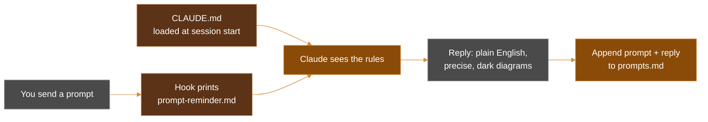
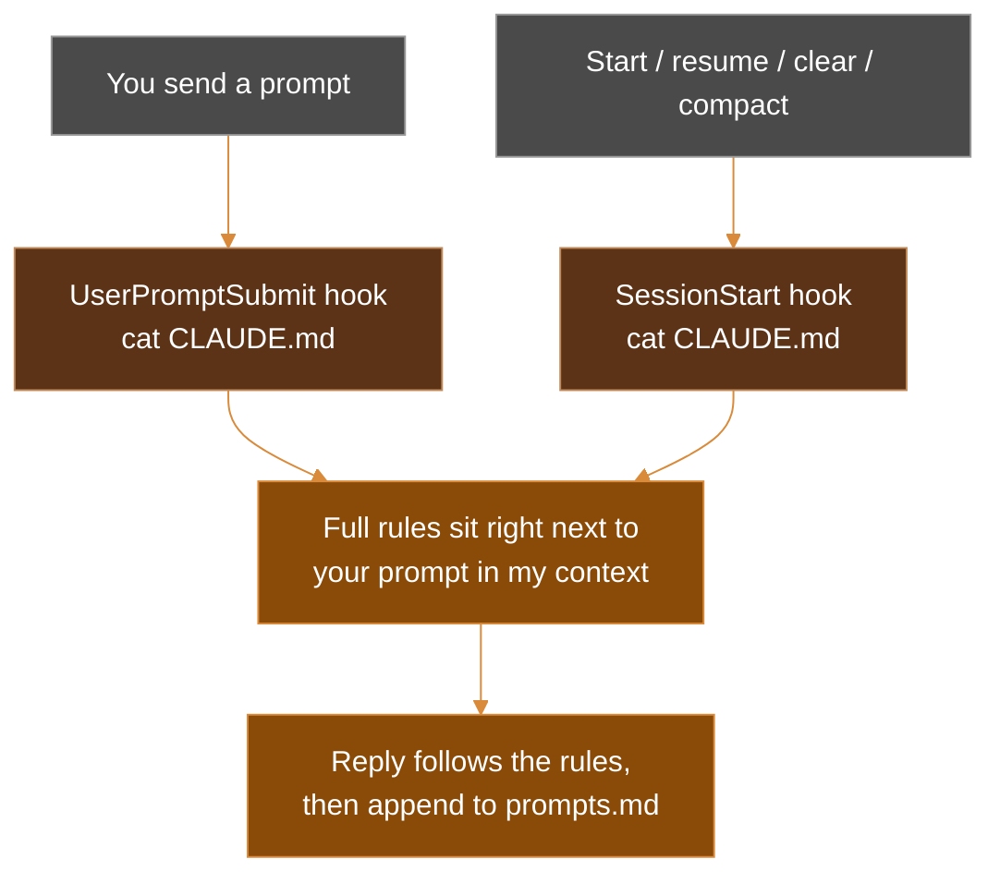
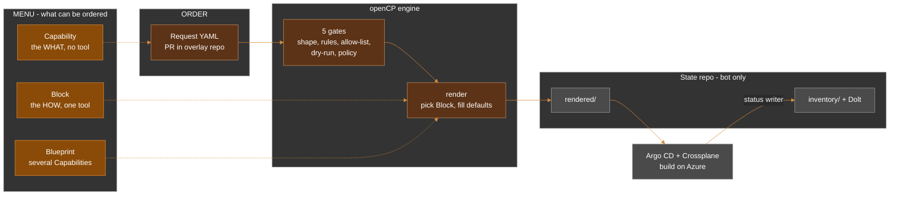
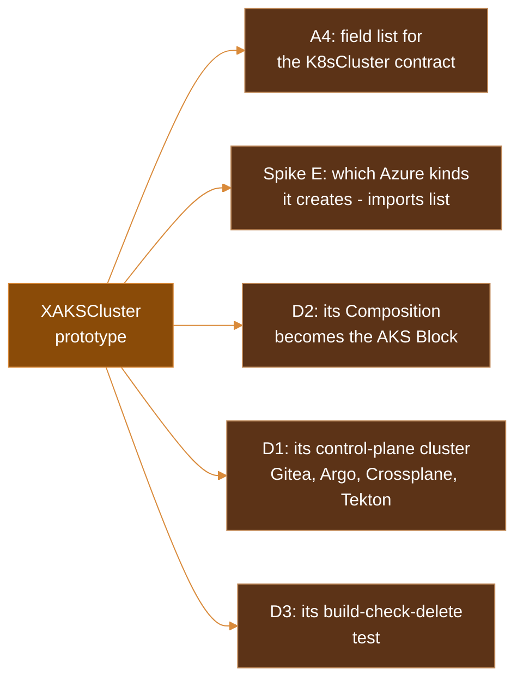

# prompts.md

Running log of every prompt and response in this repo's Claude session. Updated every turn.

---

## Turn 1

### Prompt

read the two md files in this repo, understand them first, also understand the co-relation between them, and then tell me what you and i need to work on? only brainstorm with me now, no actions yet.

### Response

I read both files in full, all 1,947 lines of v5 and all 687 of the plan.

## How they relate

- **v5 is the design.** It covers what the system is, why, and the 47 decisions in its log.
- **The plan is the build schedule for v5's openCP side.** It covers everything that doesn't need the CUE imports repo, which your teammate owns.
- **The plan reorders v5's build order (§21).** v5 builds imports first. The plan builds the kernel, contracts, render and cloud slice first, with `mapping` and `requiresCue` optional. It then joins the imports in an hour.
- **The plan also pulls three things earlier than v5 suggests.** Dolt, the release pipeline and OCI packaging are all in the 3 days. v5's open question 6 said to do Dolt after the first slice works.
- **The plan makes design choices v5 doesn't have.** Blueprint as a CUE `#Expand` function, Workflow steps that can only call `task`, Python tools, and the frozen gate-result and adapter interfaces. None of these are in v5's decision log yet.

## What I think we need to work on

**1. Is "full scope in 3 days" the real target? I'd decide this first.**
- The plan has about 45 tasks. Four parallel Claude sessions can write that much code, but you are the review bottleneck.
- Every lane has hour-long tasks that depend on real tool behavior (CUE flags, XRD form, Argo, Tekton, Kyverno, cosign, oras, Dolt). Each one is a possible surprise.
- I'd keep the plan's structure but add explicit checkpoints. A candidate cut line is: spikes, kernel, `K8sCluster`, validate and render, then the AKS slice. Everything else becomes day 3 or later if it slips.
- Do you want to use it as written, or phased with a cut line?

**2. Design gaps to close before the interfaces freeze (S3).**
- **`mapping.cue` versus the Composition.** v5 §6.10 shows `#Map` as a type-checked in→out. §8.2 also says the Block's `source` is the existing Composition. Nothing says how the two relate. Does `mapping.cue` generate the Composition's resources, only type-check them, or sit beside them? This decides what the "one-hour join" really is.
- **Which Azure tool the Composition creates.** It could be the Crossplane Azure provider or ASO. This is spike E, and it gates your teammate's first imports.
- **`outputs`.** `capability.yaml` lists `outputs`. It isn't clear whether they appear in the CUE schema, only in the XRD `status`, or both.
- **Target facts reaching the Composition.** v5 leaves this open: `spec.resolved`, or a Crossplane EnvironmentConfig.
- **Policy tier enforcement (B7).** "`custom/` can't weaken an `enforced` Policy" is easy to state. It's less obvious how to implement it with CUE unification and file layout.
- **Gate 4 versus gate 5 ordering.** Gate 4 (the dry-run render) lands on day 1. Gate 5 (Policy) lands on day 2.

**3. Inconsistencies inside the plan.**
- **Lane ownership.** A8 (lane A) writes `workflow.py`, which lane C owns. A11 (lane A) changes `catalog:build`, which lane B owns. This breaks rule 2 about lanes not colliding.
- **Order dependency.** C7's deletion `block` mode needs the adapter's `get-approvals`, but the adapters come on day 3 (C9). Day 2 needs a stub.
- **File paths.** The plan says `docs/opencp-...-v5.md`, but both files are untracked at the repo root on branch `service-catalog`. It also refers to an `opencp-3-day-plan.md` that isn't in the repo.
- **Rendered path layout.** v5's §7.3 layout and its Blueprint example (§9.3) don't quite match.

**4. Inputs that aren't in this repo.**
- The plan relies on your `XAKSCluster` prototype in `platform/crossplane/`, and on a control-plane cluster with Gitea, Argo CD, Crossplane, Tekton, the Grafana stack and a registry. This repo has only the two markdown files.
- Where does the prototype live, and what is its state?
- Do the tools exist on this machine (`cue`, `task`, `kubectl`, `crossplane`, `oras`, `cosign`)?
- Is there a capped dev Azure subscription?

**5. Things only you can do.**
- **Send `imports-handoff.yaml` to your teammate.** It's the one external dependency, and the sooner it goes, the sooner the join step happens.
- **Sort the prototype's fields into buckets (A4 step 1).**
- **Decide the S0 choices.** These are the `opencp.dev` domain, the API groups, Gitea plus Tekton, and the registry.

**6. Housekeeping.**
- Fold the plan's F-1 to F-11 decisions back into v5's decision log. Two documents with separate decision numbers will drift apart.
- Commit the two files, or at least decide where they live (`docs/` per the plan).
- Check that the lane/worktree setup works with how you run Claude sessions.

## Questions for you

1. Is the 3 days a hard deadline (a demo?), or is it a forcing function? That changes how aggressively I'd cut.
2. Where is the AKS prototype, and does Azure access exist today?
3. What do you want to tackle first: the design gaps in item 2, or the plan realism in item 1?

I'd start with item 2's `mapping.cue` question and the spike E answer. That pair affects the most downstream work.

---

## Turn 2

### Prompt

i am not able to read properly what you responded, in this stupid tmux session and small terminal window. write the exact same to prompts.md file; this prompts file should be used to record every prompt I gave you and your response. so, make sure to constantly update this prompts.md file for every turn/iteration/chat-conversation/etc. did you understand what I am asking here?

### Response

Yes. You want `prompts.md` in the repo root to be a running log of every prompt you give me and my full response, updated on every turn from now on. I'll write the first turn now, then add this turn too.

(Created `prompts.md` with Turn 1, then appended this Turn 2. Final confirmation is in the next message below.)

I created `/home/cpaladugu/opencp-dev-repos/opencp/prompts.md`. It holds Turn 1 (your brainstorm prompt and my full response, copied word for word) and Turn 2 (this request).

I also saved a memory note, so the log should carry on in later sessions.

From now on I'll append each prompt and my full response at the end of every turn. This final message will be added as part of Turn 2 on my next write. A response can only be logged once it exists, so the log always runs one message behind.

The file is untracked, like your other two markdown files. I haven't committed anything.

For the small window, `less prompts.md` or `glow prompts.md` should be easier to read than the terminal output.

---

## Turn 3

### Prompt

make that prompts.md rule as claude settings' rule so that you don't forget in future. do that claude setting for this repo at repo's root level. 

also, add the below as special instructions/skill:
```
For every chat we have, follow these instructions strictly:
- Respond to me in simple, plain English to make it easy for me to understand what you are telling me. 
- Be precise in your response by sticking to the topic and context; do not give me unnecessary extra information unless you feel there is a need for me to know something, I missed something, or it's an idea I am brainstorming with you. 
- Use diagrams to make it easy for me to understand what you are telling me; use mermaidjs diagrams like mindmap diagram, flow diagram, flow charts diagram, tree diagram, dependency diagram, etc., and also ASCII diagrams, but use relevant and meaningful diagrams that make sense in the context/topics. Also, use dark grey background, for diagrams if background is needed use dark grey or dark orange or dark brown for the diagram components, and the text color should be always white so that the text is always visible on those dark backgrounds.
```

both (prompt.md file updates rule and diagrams rule) should be read every time when I give a prompt and in future when I add claude commands, etc. This way my claude sessions don't forget these and don't hallucinate after several iterations/turns. did you get what I am asking here?

### Response

Yes, I got it, and it's set up. Your rules are now in three files at the repo root.

| File | What it does |
|---|---|
| `CLAUDE.md` | The full rules. Claude loads it at the start of every session in this repo, and commands and skills see it too. |
| `.claude/prompt-reminder.md` | A short copy of the rules. |
| `.claude/settings.json` | Two hooks. Each one prints the short copy into my context at session start and again on every prompt you send. |

This is how the rules reach me on each prompt:



Two things to know:

1. **Restart to turn the hooks on.** I haven't checked that they run yet. Claude Code may ask you to approve them, or show them in `/hooks`. Until then, `CLAUDE.md` still covers the rules.
2. **I still write the log myself.** The hook reminds me on every prompt, but nothing forces the write. I can add a `Stop` hook that copies each prompt and reply from the session transcript into `prompts.md` automatically. That works even if I forget. Want me to add it?

I didn't make a skill. A skill only loads when it's called, but `CLAUDE.md` plus the hook load every time, which is what you asked for. I haven't committed anything.

---

## Turn 4

### Prompt

how can you be so sure that CLAUDE.md file will be read every time? I know for sure claude doesn't read it every time; i proved it several times in past. so, you need to add a rule or setting or hook or command or something that will enforce claude to read claude.md file every time along with the prompts.md related rule and diagrams rule. you got it?

### Response

Yes, I got it, and you're right. `CLAUDE.md` is loaded once at the start of a session. After many turns, or after the conversation gets compacted, it can fade or drop out. I was wrong to sound sure about it.

**The fix:** the hooks now push the **whole `CLAUDE.md`** into my context, not a short copy. That happens on **every prompt**, and again after any restart, resume, `/clear` or compaction.



**What changed:**

| File | Change |
|---|---|
| `.claude/settings.json` | Both hooks now print the full `CLAUDE.md`. |
| `.claude/prompt-reminder.md` | Deleted. `CLAUDE.md` is now the only copy, so the two can't drift apart. |
| `CLAUDE.md` | Now tells Claude to trust the copy that comes with each prompt, not its memory. |

**What I checked:**
- The hooks are already running. Your last prompt arrived with the rules attached by the hook.
- The new `settings.json` is valid JSON.
- Running the hook command by hand prints `CLAUDE.md`.

**What I couldn't check:**
- I haven't seen the new full-file version fire on a real prompt yet. Your next prompt will show it.
- A hook guarantees that I *see* the rules on every prompt. It can't force me to *obey* them. The only rule a script can fully enforce is the `prompts.md` log: a `Stop` hook can copy each prompt and reply from the session transcript, with no action from me. Do you want that added?

---

## Turn 5

### Prompt

(ran `/hooks`, dismissed)

my in-line responses below (these are not responses to everything you asked previously; i only did partial response since i want to start fresh with you):

```
How they relate
v5 is the design. It covers what the system is, why, and the 47 decisions in its log.
The plan is the build schedule for v5's openCP side. It covers everything that doesn't need the CUE imports repo, which your teammate owns.
The plan reorders v5's build order (§21). v5 builds imports first. The plan builds the kernel, contracts, render and cloud slice first, with mapping and requiresCue optional. It then joins the imports in an hour. -- my response: yes, the plan doc is to help me to finish my parts of the work, while my teammate is working on cue imports; he is working on cue imports alone, and i need to work on the opencp side of the things. 
The plan also pulls three things earlier than v5 suggests. Dolt, the release pipeline and OCI packaging are all in the 3 days. v5's open question 6 said to do Dolt after the first slice works. -- my response: yes, let's stick with the plan doc.
The plan makes design choices v5 doesn't have. Blueprint as a CUE #Expand function, Workflow steps that can only call task, Python tools, and the frozen gate-result and adapter interfaces. None of these are in v5's decision log yet. -- my response: yes, let's stick with the plan doc.
```

both the docs I gave you were brainstorming items I had in a single chat with Fable & Sonnet LLMs. they are not final docs; FYI. that is why i am brainstorming with you here.

I want you to understand the design doc first and then help me with a solid plan for implementing the items that are discussed in the doc plan (fable gave me which i shared with you). so, go re-read both docs and let's brainstorm properly. did you understand what i am asking here?

### Response

Yes, I understood. Here's what you're asking, in my words:

- **You** build the openCP side. **Your teammate** builds the CUE imports repo, alone.
- **Scope = the plan doc**, including Dolt, release pipeline, OCI packaging, Blueprint `#Expand`, Workflow-calls-only-`task`, Python tools, frozen interfaces.
- Both docs are **drafts** from an earlier chat, not final. We can change them.
- **Goal:** first make sure I understand the design, then build a solid implementation plan together.

About re-reading: both files are unchanged since I read them in full in Turn 1 (I checked the timestamps), so I'm working from the complete text.

### Step 1: my understanding of the design — please correct me



In one paragraph: a user writes a short, tool-free Request (e.g. "small K8s cluster on azure-dev"). CI checks it in 5 gates. After merge, a deterministic render picks exactly one Block, fills in defaults and Target facts, and commits the final manifest to a bot-only state repo. Argo CD syncs it; Crossplane builds the real thing. A status writer records what exists (git files and/or Dolt); live signals go to Grafana via OTel. Nothing runtime ever flows back into "what we want". CUE is the one schema source; OpenAPI, XRDs, docs and tool specs are generated. Tool-specific types come from your teammate's imports and are used **only** inside Blocks.

### How I suggest we brainstorm

```
1. Design check     you confirm or correct the picture above
        |
2. Open questions   decide the few design gaps that block coding
        |
3. Plan shape       order, lanes, checkpoints, what you vs Claude do
        |
4. Final plan doc   written into the repo, replaces the Fable plan
```

To start step 1, three quick questions:

1. Is the picture above right, or is anything off?
2. Where is your `XAKSCluster` prototype (path or repo)? The plan builds on it.
3. Does your Composition use the **Crossplane Azure provider** or **ASO**? This affects what you hand to your teammate.

---

## Turn 6

### Prompt

Is the picture above right, or is anything off? -- your description is correct. 
Where is your XAKSCluster prototype (path or repo)? The plan builds on it. -- what is the significance of XAKSCluster prototype (path or repo)? can we do our work without relying on it or building something ourselves, or what are the gaps here?
Does your Composition use the Crossplane Azure provider or ASO? This affects what you hand to your teammate. -- both crossplane and aso; they both are used in different layers of the infra handling.

### Response

Good, the design picture is confirmed. Now your two points.

## 1. Why the plan leans on the `XAKSCluster` prototype

The plan uses it in **5 places**. Each one has a "build it ourselves" option:



| Plan item | With the prototype | Without it (we build) | Gap / cost |
|---|---|---|---|
| A4 contract fields | Sort real, proven fields into buckets | Design fields from what AKS, EKS, GKE share | Small. Arguably cleaner. |
| Spike E (imports list) | Read the Azure kinds it uses | We choose the kinds | Small, but your teammate waits on our choice |
| D2 AKS Block | Move and re-point an existing Composition | Write a new Composition from zero | **Big.** A working AKS Composition takes real debugging time on Azure |
| D1 control plane | Already has the tools installed | Install Gitea, Argo CD, Crossplane, ASO, Tekton, Grafana, registry | **Big.** Easily a day of setup |
| D3 test | Reuse its build-check-delete test | Write a new one | Medium |

**My take:** the offline work (lanes A, B, C, about 70% of the plan) does **not** need the prototype at all. Only lane D (the real-Azure part) gets much faster with it.

So I suggest a **hybrid**:
- Design the contract **fresh**, from the design doc, not from the prototype's field names.
- **Reuse** the prototype's control plane and the working Azure pieces of its Composition, re-pointed at the new contract.

If the prototype is not available, the plan still works. Lane D just grows by about a day.

## 2. Both Crossplane and ASO — what that changes

This matters more than it looks. Four things change:

1. **Imports handoff.** Your teammate needs **three** tool modules, not two: Crossplane core, the **Crossplane Azure provider** kinds, and the **ASO** kinds. Only the kinds the Compositions actually use.
2. **`mapping.cue`** in the AKS Block will import from **both** modules.
3. **Deletion modes** (`delete` / `orphan`) work differently in each tool:
   - Crossplane provider: `managementPolicies` (leave out `Delete`).
   - ASO: an annotation, `serviceoperator.azure.com/reconcile-policy: detach-on-delete`.
   The Block must set **both**, per resource. The design doc only mentions the Crossplane way. **This is a design gap.**
4. **The Block's `provisioner` field** is one value today. With two tools in one Block, it should become a list, e.g. `provisioners: [crossplane, aso]`, so Block choice (rule step 3) checks both are enabled.

```
K8sCluster (final manifest)
   |
   v
Crossplane Composition  (the Block)
   |-- layer X --> Crossplane Azure provider resources   (deletion: managementPolicies)
   |-- layer Y --> ASO resources                          (deletion: reconcile-policy annotation)
```

## Questions for you

1. **Which layer uses which tool?** For example: network and resource group via the Crossplane provider, the AKS cluster itself via ASO? Or the other way round?
2. **Does the Composition create the ASO objects** (Crossplane composing ASO resources), or are they applied separately?
3. **Is the prototype usable today** (code you can reach, cluster still running), and do you want the hybrid approach?
